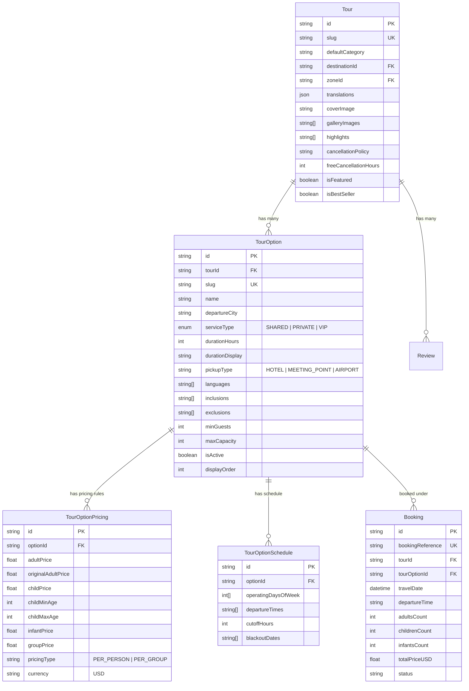

# TALAGO TOURS — Comprehensive Marketplace Architecture & Catalog Audit

**Audit Date:** October 20, 2026  
**Auditor:** Senior Full-Stack Engineer & Travel Marketplace Product Architect  
**Target Platform:** TALAGO Tours (Egypt / Red Sea / Nile Valley & Desert Oases)  
**Status:** Phase 1 Complete (Read-Only Audit — Awaiting Approval Before Any Implementation)

---

## Executive Stack Detection & Platform Overview

| Layer | Detected Technology / Provider | Configuration & Active Implementation |
|---|---|---|
| **Framework** | Next.js 14.2.35 (React 18.3, App Router) | Server Components default, Selective `'use client'` |
| **ORM & Database** | Prisma 6.19.3 & PostgreSQL on Supabase | Transaction connection pooler (port 6543) + Direct connection (5432) |
| **Storage & Assets** | Supabase Storage (`talago-tour-media` bucket) | S3-compatible cloud storage for tour hero, gallery, & boarding passes |
| **Admin & CMS** | Custom Next.js Admin (`/admin`) | Unified tour builder, settings, media library, operations, bookings, crew |
| **Payment Gateways** | Paymob (Credit Cards / Mobile Wallets / Cash on Arrival) | Configured in `src/utils/paymob.ts` and `/api/checkout/initialize` |
| **Email Service** | Resend (`resend` SDK v6.32.0) | Automated booking vouchers & PDF e-ticket dispatch |
| **WhatsApp Service** | Green API (Instance REST integration) | Digital QR voucher & passenger dispatch dispatch notifications |
| **Styling & Icons** | Tailwind CSS 3.4 + Lucide React | Curated luxury navy/gold/cyan theme (`#070F1E`, `#FFD700`, `#00E5FF`) |
| **Localization** | Hand-written `LanguageContext` + 8 locales | Supported: `en`, `de`, `ru`, `it`, `fr`, `pl`, `es`, `uk` |

---

## 1. Duplicate & Overlapping Tours Audit

The platform currently stores **75 tours** in the database. A detailed semantic and operational audit reveals that **55 of these 75 listings (73.3%)** are redundant duplicate listings of the exact same core experiences, fragmented by departure city, vehicle type, or slight package add-ons.

On world-class OTAs like **GetYourGuide**, **Viator**, and **Klook**, each master experience has a single authority listing with selectable **Variants / Options** (Departure City, Group Tier, Transportation, Package Inclusions).

Below are the **13 Master Experience Clusters** representing these 55 listings, their duplicate breakdown, and the proposed master consolidated structure.

---

### Cluster 1: Cairo, Giza Pyramids & Museums Day Trip
* **Master Title Proposal:** Cairo & Giza Pyramids Day Trip with Grand Egyptian Museum or Tahrir
* **Proposed Master Slug:** `cairo-pyramids-museum-day-trip`
* **Destination:** Cairo (`cairo`)
* **Category:** Cultural
* **Fragmented Listings (10 listings):**
  1. `cmuq6hmq40004x6k4spogjhzd` | `cairo-pyramids-day-trip-from-hurghada` | $45 (orig: $60) | 22h | Shared Coach from Hurghada | Tahrir Museum
  2. `cmuq6g48f000fx6hva1dlqutg` | `cairo-pyramids-grand-egyptian-museum` | $45 (orig: $60) | 22h | Shared Coach from Hurghada | GEM
  3. `cmsv3kftz000quv2wu9e5kbhe` | `cairo-gem-pyramids-day-trip` | $90 (orig: null) | 22h | Shared Coach from Hurghada | GEM
  4. `cmsv3kgrj000suv2wwgbjevpg` | `cairo-tahrir-museum-pyramids` | $65 (orig: null) | 22h | Shared Coach from Hurghada | Tahrir Museum
  5. `cmu4xn7de000huvdobzowaiwp` | `cairo-grand-egyptian-museum-from-sharm` | $78 (orig: $110) | 20h | Shared Coach from Sharm El Sheikh | GEM
  6. `cmu4xn6tq000fuvdozgz0fzcn` | `cairo-pyramids-day-trip-from-sharm` | $55 (orig: $75) | 20h | Shared Coach from Sharm El Sheikh | Tahrir Museum
  7. `cmuhuntug000ruvekr1ygdftm` | `cairo-pyramids-grand-egyptian-museum-marsa-alam` | $100 (orig: $120) | 18h | Flight Trip from Marsa Alam | GEM
  8. `cmuqxpdkt0016uvtobbnp19n7` | `cairo-pyramids-of-giza-sphinx-museum-day-tour` | $85 (orig: $130) | 18h | Shared Tour Cairo Local / Red Sea | Giza & Sphinx
  9. `cmuq6hpob0008x6k4s5nyugku` | `cairo-pyramids-by-plane` | $230 (orig: $280) | 14h | Private Tour by Domestic Plane | Giza & Museum
  10. `cmuq6hoc00006x6k4uak1txrz` | `grand-egyptian-museum-super-tour` | $80 (orig: $100) | 22h | Shared Tour from Hurghada | GEM Focus
* **What Differs:** Departure point (Hurghada / Sharm / Marsa Alam / Cairo), Transport mode (Air-conditioned luxury coach vs. 45-minute domestic flight), Museum visited (Grand Egyptian Museum GEM vs. Old Egyptian Museum Tahrir), Group size (Shared big bus vs. Small group max 8 vs. Private Egyptologist guide).
* **Master Options Architecture:**
  - **Option A:** From Hurghada by Coach — GEM or Tahrir Museum ($45 - $65)
  - **Option B:** From Sharm El Sheikh by Coach — GEM or Tahrir Museum ($55 - $78)
  - **Option C:** From Cairo Hotels (Local Tour) — Pyramids, Sphinx & GEM ($45)
  - **Option D:** VIP Day Trip by Plane (Round-trip flights from Hurghada/Sharm/Marsa Alam + Private Guide) ($230 - $280)

---

### Cluster 2: Luxor Highlights & Ancient Thebes Day Trip
* **Master Title Proposal:** Luxor Valley of the Kings, Karnak & Hatshepsut Highlights Day Trip
* **Proposed Master Slug:** `luxor-valley-of-the-kings-karnak-day-trip`
* **Destination:** Luxor (`luxor`)
* **Category:** Cultural
* **Fragmented Listings (8 listings):**
  1. `cmuq6g2tj000dx6hv7ohnki8s` | `luxor-day-trip-from-hurghada` | $45 (orig: $60) | 18h | Hurghada departure | Valley of the Kings
  2. `cmuq6h9lh0006x6jk8etafust` | `luxor-mini-group-tour` | $75 (orig: $95) | 18h | Hurghada departure | Small group max 8
  3. `cmsv3kvd6001euv2wm4gubxmk` | `luxor-mini-group-valley-kings` | $90 (orig: null) | 18h | Hurghada departure | VIP Mini-group max 9
  4. `cmsv3ktly001cuv2w61zac17b` | `luxor-valley-kings-day-trip` | $65 (orig: null) | 18h | Hurghada departure | Karnak & Valley of Kings
  5. `cmsv3kr3r001auv2wwd8h1iyu` | `luxor-valley-queens-day-trip` | $60 (orig: null) | 18h | Hurghada departure | Valley of the Queens
  6. `cmuhunt8v000puvekik8n0c62` | `luxor-valley-of-kings-from-marsa-alam` | $110 (orig: $150) | 15h | Marsa Alam departure | Valley of the Kings
  7. `cmuqxpd6c0014uvtovneqzjuz` | `luxor-valley-of-the-kings-karnak-day-trip` | $85 (orig: $125) | 16h | Luxor/Hurghada departure | Master highlights
  8. `cmuq6haxw0008x6jkgmxyf9n0` | `luxor-dendera-super-tour` | $55 (orig: $75) | 18h | Hurghada departure | Dendera Temple addition
* **What Differs:** Departure hub (Hurghada / El Gouna / Makadi vs. Marsa Alam vs. Luxor local), Tomb sites included (Valley of the Kings vs. Valley of the Queens vs. Dendera Temple of Hathor), Group configuration (Standard coach vs. Mini-group 8 pax vs. Private vehicle & Egyptologist).
* **Master Options Architecture:**
  - **Option A:** Classic Day Trip from Hurghada (Karnak + Valley of the Kings + Hatshepsut) ($55)
  - **Option B:** VIP Small Group from Hurghada (Max 8 Guests in Luxury Minivan) ($85)
  - **Option C:** Day Trip from Marsa Alam / Port Ghalib ($110)
  - **Option D:** Dendera & Luxor Temple Combo ($75)
  - **Option E:** Private VIP Tour with Dedicated Egyptologist ($140)

---

### Cluster 3: Sataya Dolphin Reef Snorkeling Yacht Expedition
* **Master Title Proposal:** Sataya Dolphin Reef Snorkeling Yacht Expedition & Wild Dolphin Swim
* **Proposed Master Slug:** `sataya-dolphin-reef-marsa-alam`
* **Destination:** Marsa Alam (`marsa-alam`)
* **Category:** Sea
* **Fragmented Listings (2 listings):**
  1. `cmuhunnwl000duvekem2v76v2` | `sataya-dolphin-reef-marsa-alam` | $65 (orig: $90) | 9h | Hamata Port departure | Yacht cruise
  2. `cmuqxpcdy0010uvtov97zd187` | `sataya-dolphin-reef-marsa-alam-luxury-cruise` | $55 (orig: $85) | 8h | Hamata Port departure | Luxury yacht cruise
* **What Differs:** Almost nothing. Identical Hamata departure, identical reef destination, identical itinerary. The prices ($65 vs $55) and durations (9h vs 8h) were created by two separate seeding scripts.
* **Master Options Architecture:**
  - **Option A:** Standard Yacht Cruise with Buffet Lunch & Snorkel Gear ($55)
  - **Option B:** VIP Upper-Deck Luxury Yacht with Marine Park Fees Included ($75)

---

### Cluster 4: Hurghada Desert Quad, Buggy & Bedouin Safari
* **Master Title Proposal:** Hurghada Desert Safari: Quad Bike ATV, Buggy, Camel & Bedouin Dinner
* **Proposed Master Slug:** `hurghada-desert-quad-safari-experience`
* **Destination:** Hurghada (`hurghada`)
* **Category:** Safari
* **Fragmented Listings (9 listings):**
  1. `cmsv3kcjh000euv2w27khtq1v` | `desert-safari-3h-atv` | $18 (orig: null) | 3h | Morning ATV only + tea
  2. `cmuq6g726000jx6hvloyd9xz1` | `hurghada-moto-safari-quad-bikes` | $20 (orig: $30) | 3h | Morning quad safari
  3. `cmsv3kd3d000guv2wijhvpu3b` | `desert-safari-3h-dinner-show` | $23 (orig: null) | 5h | Afternoon ATV + dinner show
  4. `cmsv3ke6r000kuv2wb78ey2oy` | `family-safari-hurghada` | $20 (orig: null) | 4h | Quad, buggy, jeep & camel
  5. `cmuq6g5nb000hx6hv6j7g7aqb` | `hurghada-desert-super-safari-quad-bedouin` | $18 (orig: $28) | 6h | Evening super safari
  6. `cmuqxpasu000suvtokpvcr10r` | `hurghada-mega-safari-quad-buggy-bedouin-dinner` | $28 (orig: $45) | 6h | Mega safari
  7. `cmsv3kdn3000iuv2wzaqluc3o` | `royal-safari-hurghada` | $27 (orig: null) | 5h | VIP Royal safari
  8. `cmsv3keqh000muv2wr42uqe83` | `super-safari-hurghada` | $23 (orig: null) | 5h | Super safari
  9. `cmsv3kfa5000ouv2wp0jnyq5k` | `star-gazing-safari-hurghada` | $38 (orig: null) | 6h | Telescope stargazing + dinner
* **What Differs:** Start time (Morning 08:00 AM vs Sunset 02:00 PM), Equipment used (Single ATV vs Double ATV vs 4-seater Dune Buggy vs Jeep 4x4 convoy), Evening entertainment (Ride-only vs Bedouin BBQ, Tanoura dance, belly dancing & telescope stargazing).
* **Master Options Architecture:**
  - **Option A:** 3-Hour Morning Quad Adventure (ATV ride + Bedouin tea) ($20)
  - **Option B:** 5-Hour Afternoon Super Safari (Quad + Spider Buggy + Camel + BBQ Dinner & Show) ($28)
  - **Option C:** Family Buggy & Jeep Convoy Safari ($25)
  - **Option D:** VIP Night Stargazing Safari with Astronomer & Telescope ($38)
  - **Option E:** Private Sunset Quad Safari (Guide & private convoy) ($50)

---

### Cluster 5: Giftun Island, Orange Bay & Paradise Beach Cruises (Hurghada)
* **Master Title Proposal:** Giftun Island National Park: Orange Bay, Paradise Island & Snorkeling Cruise
* **Proposed Master Slug:** `giftun-island-orange-bay-cruise`
* **Destination:** Hurghada (`hurghada`)
* **Category:** Sea
* **Fragmented Listings (5 listings):**
  1. `cmuq6fyab0007x6hvvfbkwufc` | `orange-bay-giftun-island-day` | $35 (orig: $50) | 8h | Orange Bay island stop
  2. `cmuqxp5yd000quvtoexrkqzl6` | `giftun-island-orange-bay-luxury-cruise` | $35 (orig: $55) | 7h | Orange Bay VIP yacht
  3. `cmsv3kwcc001guv2w2sfktrfr` | `orange-bay-island-hurghada` | $23 (orig: null) | 7h | Standard Orange Bay boat
  4. `cmuq6fzzs0009x6hva2jtydj5` | `orange-bay-sunset-cruise` | $30 (orig: $45) | 5h | Sunset cruise
  5. `cmsv3kwxb001iuv2wa4upgzwa` | `hula-hula-paradise-island-hurghada` | $21 (orig: null) | 7h | Paradise Island beach
* **What Differs:** Island beach club visited (Orange Bay Caribbean-style wooden swing beach vs Paradise Island white sands vs open Giftun reef), Boat standard (Standard cruiser vs VIP luxury yacht with seafood buffet vs sunset departure).
* **Master Options Architecture:**
  - **Option A:** Classic Orange Bay Boat Trip with Lunch & Snorkeling ($25)
  - **Option B:** VIP Luxury Yacht Cruise with Seafood Buffet ($38)
  - **Option C:** Paradise Island Beach Club Day with Coral Reef Snorkel ($28)
  - **Option D:** Orange Bay Sunset Cruise (Golden hour departure) ($32)
  - **Option E:** Private Speedboat Charter to Orange Bay (2 or 4 Hours) ($150)

---

### Cluster 6: Ras Mohamed National Park & White Island (Sharm El Sheikh)
* **Master Title Proposal:** Ras Mohamed National Park & White Island Luxury Yacht Cruise
* **Proposed Master Slug:** `ras-mohamed-white-island-yacht-cruise`
* **Destination:** Sharm El Sheikh (`sharm-el-sheikh`)
* **Category:** Sea
* **Fragmented Listings (4 listings):**
  1. `cmu4xn5qm000buvdoy539p921` | `ras-mohamed-white-island-luxury-cruise` | $38 (orig: $55) | 8h | Yacht Cruise
  2. `cmuqxpb7t000uuvtoohg4zntv` | `ras-mohamed-white-island-luxury-yacht-sharm` | $38 (orig: $60) | 7h | VIP Cruise
  3. `cmu4xnbfl000ruvdot9h9ptk1` | `scuba-diving-white-island-ras-mohamed` | $55 (orig: $80) | 8h | With Scuba Dive
  4. `cmu4xn6ae000duvdoof366hrg` | `ras-mohamed-national-park-bus-tour` | $24 (orig: $35) | 5h | Land Bus Tour
* **What Differs:** Access method (Sea Cruise by yacht vs Land Bus tour visiting Mangroves and Magic Lake), In-water activity (Snorkeling only vs Introductory Scuba Dive with instructor).
* **Master Options Architecture:**
  - **Option A:** Full-Day Luxury Yacht Cruise with Snorkeling & White Island ($38)
  - **Option B:** Yacht Cruise with 1 Introductory Scuba Dive ($55)
  - **Option C:** Yacht Cruise with 2 Guided Dives for Certified Divers ($70)
  - **Option D:** Half-Day Overland Park Tour by Bus (Magic Lake, Mangroves, Earthquake Crack) ($25)

---

### Cluster 7: Mount Sinai (Mount Moses) & St. Catherine Sunrise Trek
* **Master Title Proposal:** Mount Sinai (Mount Moses) Sunrise Trek & St. Catherine Monastery
* **Proposed Master Slug:** `mount-sinai-st-catherine-sunrise-trek`
* **Destination:** Sharm El Sheikh (`sharm-el-sheikh`)
* **Category:** Cultural
* **Fragmented Listings (2 listings):**
  1. `cmu4xnac8000puvdon45zjt99` | `mount-moses-st-catherine-sunrise-hike` | $42 (orig: $60) | 14h | Overnight trek
  2. `cmuqxpbjn000wuvtovdadjy5k` | `mount-sinai-sunrise-st-catherine-monastery-tour` | $45 (orig: $70) | 14h | Sunrise hike
* **What Differs:** Identical overnight hike departing Sharm at 21:00 PM, climbing summit at dawn, touring monastery in morning. Cloned listings with a $3 price variance.
* **Master Options Architecture:**
  - **Option A:** Standard Shared Trek with Bedouin Guide & Monastery Entry ($42)
  - **Option B:** Private Guide & Private Vehicle Transfer ($95)

---

### Cluster 8: Abu Dabbab Bay Green Turtle & Dugong Snorkeling
* **Master Title Proposal:** Abu Dabbab Bay Snorkeling: Giant Green Sea Turtles & Dugong Sanctuary
* **Proposed Master Slug:** `abu-dabbab-sea-turtles-dugong-snorkeling`
* **Destination:** Marsa Alam (`marsa-alam`)
* **Category:** Sea
* **Fragmented Listings (2 listings):**
  1. `cmuhunrj3000juvekvk4sv2nj` | `abu-dabbab-bay-turtles-dugong-snorkeling` | $38 (orig: $55) | 6h | Beach day + snorkeling
  2. `cmuqxpcse0012uvtopi5k0rp8` | `abu-dabbab-sea-turtle-dugong-bay-snorkeling` | $35 (orig: $50) | 6h | Turtles & dugong
* **What Differs:** Identical tour in Marsa Alam with $3 price difference created by two seeders.
* **Master Options Architecture:**
  - **Option A:** Beach Entry, Sunbed & Guided Coral Reef Snorkel ($35)
  - **Option B:** All-Inclusive Beach Day with Buffet Lunch & Speedboat Dugong Search ($55)

---

### Cluster 9: Hurghada Luxury Turkish Bath, Hammam & Spa Rituals
* **Master Title Proposal:** Hurghada Luxury Hammam & Traditional Spa Wellness Rituals
* **Proposed Master Slug:** `hurghada-luxury-hammam-spa-rituals`
* **Destination:** Hurghada (`hurghada`)
* **Category:** Spa
* **Fragmented Listings (4 listings):**
  1. `cmsv3khbf000uuv2wbu8w6mvd` | `spa-body-massage-1h-hurghada` | $17 (orig: null) | 2h | 60-min massage only
  2. `cmsv3ki9q000wuv2w3ox6bv6l` | `spa-turkish-bath-massage-hurghada` | $20 (orig: null) | 3h | Turkish Hammam + 50m massage
  3. `cmsv3kl6u0010uv2wscm0qwz7` | `spa-cleopatra-bath-massage-hurghada` | $25 (orig: null) | 3h | Cleopatra bath + coconut scrub
  4. `cmsv3kj8n000yuv2wca4eehpf` | `spa-moroccan-bath-massage-hurghada` | $25 (orig: null) | 3h | Moroccan bath + black soap scrub
* **What Differs:** Treatment package inside the exact same spa wellness facility.
* **Master Options Architecture:**
  - **Option A:** Full Body Relaxation Massage (60 min) with Sauna & Jacuzzi ($17)
  - **Option B:** Traditional Turkish Hammam & Peeling Scrub + 50-Min Body Massage ($20)
  - **Option C:** Royal Cleopatra Ritual (Coconut Scrub + Gold Facial Mask + 45-Min Massage) ($25)
  - **Option D:** Authentic Moroccan Bath (Black Soap + Kessa Glove Scrub + 50-Min Massage) ($25)

---

### Cluster 10: Hurghada Dolphin World Experiences
* **Master Title Proposal:** Hurghada Dolphin World: Live Show, Photo Session & Dolphin Swim
* **Proposed Master Slug:** `hurghada-dolphin-world-encounters`
* **Destination:** Hurghada (`hurghada`)
* **Category:** Sea
* **Fragmented Listings (3 listings):**
  1. `cmsv3kncb0012uv2wwxsldsh2` | `dolphinarium-show-hurghada` | $15 (orig: null) | 2h | Dolphin & sea lion show
  2. `cmsv3kpui0018uv2ws7zrh1su` | `dolphin-photo-session-hurghada` | $38 (orig: null) | 1h | Private photo session
  3. `cmsv3kova0016uv2wfl7l0l10` | `swim-with-dolphins-10min-hurghada` | $70 (orig: null) | 1h | 10-minute swim session
* **What Differs:** Level of interaction at the Makadi Bay Dolphin World facility.
* **Master Options Architecture:**
  - **Option A:** Live Dolphin & Sea Lion Performance Ticket ($15)
  - **Option B:** Show Ticket + Professional Printed Photo Session ($38)
  - **Option C:** Interactive Dolphin Swimming (5 Minutes) + Show Ticket ($50)
  - **Option D:** VIP Dolphin Swimming (10 Minutes) + Show Ticket ($70)

---

### Cluster 11: Hurghada Red Sea Scuba Diving
* **Master Title Proposal:** Red Sea Scuba Diving: Guided Dives for Beginners & Certified Divers
* **Proposed Master Slug:** `hurghada-scuba-diving-experience`
* **Destination:** Hurghada (`hurghada`)
* **Category:** Sea
* **Fragmented Listings (2 listings):**
  1. `cmsv3l0z6001muv2we6rs716k` | `diving-trip-red-sea-hurghada` | $25 (orig: $20 - ERROR) | 7h | 2 intro dives
  2. `cmuq6ga0y000nx6hvkiw66h58` | `hurghada-crystal-bay-diving-intro` | $30 (orig: $45) | 8h | Intro dive at Crystal Bay
* **What Differs:** Seeding duplicates with conflicting pricing and descriptions.
* **Master Options Architecture:**
  - **Option A:** Beginner Intro Diving: 2 Guided Dives with PADI Instructor ($28)
  - **Option B:** Certified Divers Package: 2 Deep Reef Dives with Tanks & Weights ($35)
  - **Option C:** Accompanying Snorkeler / Non-Diver Day Pass ($18)

---

### Cluster 12: Marsa Alam Semi-Submarine & Underwater Coral Observatories
* **Master Title Proposal:** Port Ghalib Semi-Submarine & Pharaonic Coral Observatory
* **Proposed Master Slug:** `marsa-alam-semi-submarine-coral-explorer`
* **Destination:** Marsa Alam (`marsa-alam`)
* **Category:** Sea
* **Fragmented Listings (2 listings):**
  1. `cmuhuns39000luveklgdbk4zf` | `royal-sea-scope-semi-submarine-marsa-alam` | $35 (orig: $50) | 3h | Royal Sea Scope
  2. `cmuhunsnq000nuvek3ub36y4z` | `nefertari-pharaonic-sea-experience-marsa-alam` | $55 (orig: $80) | 5h | Nefertari Pharaonic Submarine
* **What Differs:** Vessel design (Standard Royal Sea Scope vs Luxury Pharaonic styled Nefertari vessel with seafood lunch).
* **Master Options Architecture:**
  - **Option A:** Royal Sea Scope Coral Explorer (2-Hour Sub-surface Observation) ($35)
  - **Option B:** Nefertari Pharaonic Luxury Experience (Observation + Buffet Lunch & Snorkel) ($55)

---

### Cluster 13: Sharm El Sheikh Sinai Desert Quad & Super Safari
* **Master Title Proposal:** Sharm El Sheikh Sinai Desert Quad Safari & Bedouin Camp
* **Proposed Master Slug:** `sharm-desert-quad-safari-experience`
* **Destination:** Sharm El Sheikh (`sharm-el-sheikh`)
* **Category:** Safari
* **Fragmented Listings (2 listings):**
  1. `cmu4xn7wr000juvdofhh7e1st` | `desert-quad-bike-safari-sharm` | $22 (orig: $35) | 3h | Morning ATV
  2. `cmu4xn8g7000luvdoq1drahid` | `super-safari-sharm-el-sheikh` | $38 (orig: $55) | 6h | Super Safari
* **What Differs:** 3-Hour ride vs 6-Hour evening safari with camel, dinner & stargazing.
* **Master Options Architecture:**
  - **Option A:** 3-Hour Morning Sinai Desert Quad ATV Ride ($22)
  - **Option B:** 6-Hour Evening Super Safari with Camel Ride, Bedouin BBQ Dinner & Show ($38)

---

## 2. Logic & Data Inconsistencies Audit

### 2.1 Counter Discrepancies & Destination Visibility
* **Homepage Experience Counter Mismatch:**
  - **Location:** `src/app/(public)/page.tsx:86` vs `src/app/(public)/page.tsx:38` vs `src/components/landing/TourCatalog.tsx:234`.
  - **The Bug:** `page.tsx:86` calculates `activeTourCount = 75` and passes it to Hero. The Hero proudly announces: `"75 active experiences live"`. However, line 38 limits the tour query to `take: 36`. When `TourCatalog` loads, line 234 renders: `"{total} experiences available"`, which outputs **"36 experiences available"**! Travelers immediately see a blatant contradiction: 75 experiences in the hero banner vs 36 in the catalog.
* **Destinations with 0 Tours Displayed as Active:**
  - **Location:** `src/app/(public)/page.tsx:70`, `src/components/landing/PopularDestinations.tsx:64-105`, `scripts/audit_tours_dump.json`.
  - **The Bug:** The database table `Destination` contains 16 destinations. Destination `safaga` (`cmuqr7gs6000buv98vqkgk28c`) has `isVisible: true` despite having **0 published tours** (`_count.tours: 0`). The homepage displays a "Popular Destinations" card for Safaga with `"0 tours"`. Clicking it opens `/destinations/safaga`, which presents an empty catalog.
  - Furthermore, `Destination` contains **duplicate records**:
    - `"siwa-oasis"` (`cmuq6j3by0000x6ls7qpqnpy6`) with `isVisible: false` and 0 tours.
    - `"siwa"` (`cmuqr7hc3000duv98vsudq6oa`) with `isVisible: true` and 4 tours.

### 2.2 Unrealistic Durations & Pricing Arithmetic Errors
* **Unrealistic 22-Hour "Day Trips":**
  - **Location:** `scripts/audit_tours_dump.json` (slugs: `cairo-pyramids-day-trip-from-hurghada`, `cairo-pyramids-grand-egyptian-museum`, `cairo-gem-pyramids-day-trip`, `cairo-tahrir-museum-pyramids`, `grand-egyptian-museum-super-tour`).
  - **The Bug:** Day trips from Hurghada to Cairo have `durationHours: 22` and labels like `"22 Hours (Full Day)"`. To a traveler, 22 hours is an overnight journey, but it is advertised as a "Day Trip". On Viator/GYG, this is formatted as: `"Full day (~16-18h including transfers) | Early morning departure (02:00 AM)"`.
* **Original Price Cheaper Than Sales Price (Inverted Discount):**
  - **Location:** `scripts/audit_tours_dump.json` (`diving-trip-red-sea-hurghada`).
  - **The Bug:** `adultPrice: $25`, while `originalPrice: $20`! The "strikethrough" price is $20 while the sales price is $25. This shows a **negative discount** on the tour card and breaks pricing credibility.
* **BasePriceUSD vs AdultPrice Discrepancy:**
  - **Location:** `cairo-pyramids-grand-egyptian-museum-marsa-alam`.
  - **The Bug:** `basePriceUSD: 230` while `adultPrice: 100`. In `priceCalculator.ts` and API fallback routes, depending on which field is referenced, the customer is billed either $100 or $230.
* **Child Price Omission & Free Booking Flaw:**
  - **Location:** `src/utils/priceCalculator.ts:28` vs `src/app/api/checkout/initialize/route.ts:166`.
  - **The Bug:** 11 tours have `childPrice: null`. In the client calculator (`priceCalculator.ts:28`):
    ```ts
    const childTotal = (params.childPrice ?? 0) * params.childrenCount;
    ```
    Children are billed at **$0 (FREE)** on the client booking summary!
    However, on the server (`route.ts:166`):
    ```ts
    const effectiveChildPrice = tour.priceChild ?? tour.childPrice ?? effectiveAdultPrice;
    ```
    The server unexpectedly falls back to the **full Adult Price**! When the guest enters credit card details, the server attempts to charge adult price for children, triggering a validation failure or unexpected overcharge.

### 2.3 Fake Social Proof & Reviews Disconnected from Reality
* **Hardcoded Marketing Claims:**
  - **Location:** `src/locales/en.ts:127`, `src/locales/*.ts:27, 85, 127`.
  - **The Bug:** The homepage states:
    > *"Excellent — 4.9 out of 5 based on 300+ bookings"* and *"300+ verified guests"*.
  - **The Reality:** There are **only 3 bookings** in the entire database.
  - **Seeded Reviews:** There are **285 reviews** in `reviews` table, but 100% of them have `bookingId: null`. Every tour was seeded with exactly 3 to 4 artificial reviews giving identical 4.9 or 5.0 ratings.
  - **Hardcoded Testimonials:** `src/components/landing/Testimonials.tsx:14-39` renders hardcoded static reviews from `"Amelia Hart"`, `"Karim El-Nour"`, and `"Sophie Laurent"` with future dates (`"May 28, 2026"`). None of these correspond to real database records.

### 2.4 Wikipedia Copy & Hero Card Content
* **Copied Hero Concierge Card:**
  - **Location:** Database `system_settings` (`key: "banners"`) & `src/types/settings.ts:58`.
  - **The Bug:** The hero card for the Grand Egyptian Museum uses:
    > `conciergePickTitle`: *"The Grand Egyptian Museum"*  
    > `conciergePickDescription`: *"The Grand Egyptian Museum is a national archaeological museum in Giza, Egypt."*
  - This is an unedited copy of the opening sentence of Wikipedia. It doesn't describe an experience, includes no tour itinerary, has a generic price badge `"VIP All-Inclusive"`, and links to `/tours` instead of a specific booking page.
* **Hardcoded Localhost Images in Production Database:**
  - **Location:** Database `system_settings` (`key: "banners"`):
    ```json
    {
      "toursCatalogBackground": "http://localhost:3000/uploads/1780691765061-photo_2026-06-05_23-35-32-x9khs1q4.jpg",
      "destinationsBackground": "http://localhost:3000/uploads/1780691765061-photo_2026-06-05_23-35-32-x9khs1q4.jpg",
      "bookingCheckoutBackground": "http://localhost:3000/uploads/1780691765061-photo_2026-06-05_23-35-32-x9khs1q4.jpg"
    }
    ```
  - When running in production on Vercel, the browser attempts to fetch these backgrounds from the user's local machine (`http://localhost:3000`), causing mixed-content security errors and broken images.

### 2.5 Empty Content, Broken Links & Generic Social URLs
* **Generic Social Links in Footer:**
  - **Location:** `src/app/(public)/layout.tsx:70-104`.
  - **The Bug:** The footer links point to generic domain homepages:
    - `https://instagram.com`
    - `https://facebook.com`
    - `https://tiktok.com`
    - `https://t.me`
  - None point to the actual Talago Tours company channels. The admin settings panel allows configuring company social links (`settings.contact.socialLinks`), but `layout.tsx` hardcodes generic URLs and completely ignores the database settings!
* **Empty Itineraries:**
  - **Location:** `scripts/inspect_catalog_status.js:59`.
  - **The Bug:** 4 tours have completely empty itineraries:
    1. `cairo-pyramids-of-giza-sphinx-museum-day-tour`
    2. `super-safari-hurghada`
    3. `luxor-valley-of-the-kings-karnak-day-trip`
    4. `family-safari-hurghada`

### 2.6 SEO, Metadata & Schema.org Deficiencies
* **Canonical URL Mismatch on Vercel:**
  - **Location:** `src/lib/seoMetadata.ts:4`, `src/app/robots.ts:3`, `src/app/sitemap.ts:4`.
  - **The Bug:** All metadata builders default `baseUrl` to `'https://talago-tours.com'`. When the app is deployed on Vercel previews or staging domains (`talago-tours.vercel.app`), all canonical URLs, Open Graph images, and sitemaps point to the custom domain. Search engines flag this as cross-domain canonical confusion.
* **Missing Schema.org Types:**
  - `BreadcrumbList` is present on destination pages, but missing on tour detail pages (`/tours/[slug]`).
  - `FAQPage` JSON-LD is completely absent, despite tours having rich FAQ arrays in their translations.
  - The homepage has no `Organization` or `WebSite` JSON-LD.
* **Malformed `.env`:**
  - **Location:** `.env:9`.
  - **The Bug:** An accidental rogue character `"Q"` sits on line 9 between `DIRECT_URL` and `NEXT_PUBLIC_APP_URL`.

### 2.7 Booking Flow Architecture Flaws
* **Dual Conflicting Booking Endpoints:**
  - **Location:** `src/components/tours/BookingFormSteps.tsx:224` (`/api/bookings/checkout`) vs `src/components/checkout/BookingForm.tsx` (`/api/checkout/initialize`).
  - **The Bug:** Two separate checkout endpoints exist with completely divergent logic. `BookingFormSteps.tsx` calls the legacy `/api/bookings/checkout` endpoint which:
    - Does NOT create a `Transaction` row.
    - Does NOT apply promo codes or check promo validity.
    - Does NOT support Paymob online payment gateway or deposits.
    - Does NOT create or link a customer shadow profile.
* **Vercel Serverless Background Task Cancellation:**
  - **Location:** `src/app/api/checkout/initialize/route.ts:315-325`.
  - **The Bug:**
    ```ts
    void (async () => {
      const { generateAndStoreBoardingPassPdf } = await import('@/utils/pdfGenerator');
      const pdfUrl = await generateAndStoreBoardingPassPdf(result.booking.id);
      const { dispatchBookingNotifications } = await import('@/utils/notificationDispatcher');
      await dispatchBookingNotifications(result.booking.id, pdfUrl ?? undefined);
    })();
    ```
    In Next.js on Vercel, unawaited asynchronous tasks invoked with `void (async () => {})()` are immediately frozen when the response completes. Generating the PDF boarding pass and sending WhatsApp and email confirmations frequently terminates mid-execution or fails silently.

---

## 3. Detailed Issue Breakdown & Severity Matrix

| ID | Issue Description | Severity | File Path & Line | Root Cause | Concrete Fix |
|---|---|---|---|---|---|
| **ISS-01** | Fragmented duplicate tours (55 tours across 13 clusters) | **Critical** | Database `Tour` table | Tours seeded separately for each minor variation | Consolidate into 13 master tours with rich variants; preserve old slugs with 301 redirects |
| **ISS-02** | Dual conflicting checkout endpoints | **Critical** | `src/components/tours/BookingFormSteps.tsx:224` & `src/app/api/bookings/checkout/route.ts` | Legacy modal calls obsolete checkout route | Route all booking submissions through `/api/checkout/initialize` |
| **ISS-03** | Serverless background notification termination | **Critical** | `src/app/api/checkout/initialize/route.ts:315-325` | Unawaited async IIFE terminates on serverless exit | Await notification dispatch or use `@vercel/functions` `waitUntil()` |
| **ISS-04** | Client/Server child pricing mismatch ($0 vs Adult Price) | **High** | `src/utils/priceCalculator.ts:28` & `/api/checkout/initialize/route.ts:166` | Null `childPrice` handled as 0 on client but adult price on server | Enforce explicit `childPrice` (or explicit 0); standardize calculation function |
| **ISS-05** | Inverted discount price (`originalPrice < adultPrice`) | **High** | `scripts/audit_tours_dump.json` (`diving-trip-red-sea-hurghada`) | Data entry typo in seeder (`price: 25`, `orig: 20`) | Fix seed/db record (`adultPrice: 25`, `originalPrice: 35`) |
| **ISS-06** | Catalog counter contradiction (75 vs 36) | **High** | `src/app/(public)/page.tsx:38, 86` & `TourCatalog.tsx:234` | `page.tsx` queries `take: 36` but displays `totalCount` | Pass actual total count to `TourCatalog` or paginate cleanly |
| **ISS-07** | Destination with 0 tours displayed as active | **High** | `prisma.destination` (`safaga`) & `page.tsx:70` | `isVisible: true` on destination with 0 tours | Query only destinations where `tours.some(status == 'ACTIVE')` |
| **ISS-08** | Hardcoded localhost URLs in production DB | **High** | Database `system_settings` (`banners`) | Local dev uploaded assets saved with `http://localhost:3000` | Strip host; store relative `/uploads/...` or absolute Supabase storage URLs |
| **ISS-09** | Unrealistic 22-Hour Day Trip durations | **Medium** | Tour records for Cairo & Luxor | Total elapsed round-trip time logged without explanation | Normalize `durationHours: 16` and display `"Full Day (~16h with transfers)"` |
| **ISS-10** | Fake social proof & hardcoded reviews | **Medium** | `src/locales/*.ts:127` & `Testimonials.tsx:14` | Marketing text hardcoded `"300+ bookings"`, reviews detached from bookings | Compute review counts and ratings dynamically from database |
| **ISS-11** | Generic social links in footer | **Medium** | `src/app/(public)/layout.tsx:70-104` | Links hardcoded to `instagram.com` etc. | Wire footer to read `settings.contact.socialLinks` from DB |
| **ISS-12** | Wikipedia copied text on hero card | **Medium** | Database `system_settings` (`conciergePickDescription`) | Placeholder text never replaced with actual experience copy | Update copy to describe the luxury private tour with Egyptologist |
| **ISS-13** | Missing BreadcrumbList & FAQPage Schema | **Medium** | `src/app/(public)/tours/[slug]/page.tsx` | Only `TouristTrip` schema was implemented | Add `BreadcrumbList` and `FAQPage` JSON-LD to tour pages |
| **ISS-14** | Rogue character in `.env` | **Low** | `.env:9` | Stray `"Q"` character on blank line | Delete stray character |

---

## 4. Proposed New Data Model: Tour -> Options Architecture

To bring TALAGO on par with **GetYourGuide**, **Viator**, and **Klook**, we propose elevating the data model from a flat, single-tier tour table into a hierarchical relational structure:



### Key Capabilities of This Model
1. **Live Option Selector on Product Page:**
   - Guest selects departure city (e.g. *From Hurghada* vs *From Sharm* vs *From Marsa Alam*).
   - Guest toggles service level (*Standard Shared Coach* vs *Small Group Max 8* vs *Private Egyptologist*).
   - Price, inclusions, duration, and departure time update dynamically in real time without navigating away.
2. **Deterministic Pricing Engine:**
   - Each option defines explicit per-adult, per-child, per-infant, or per-group rates.
   - Eliminates all $0 child price bugs and adult price fallback ambiguities.
3. **Seamless Migration & Backward Compatibility:**
   - During Phase 2 migration, each merged duplicate tour becomes an active `TourOption` under its master tour.
   - A `tour_redirects` table guarantees that all 55 legacy URLs return HTTP 301 Permanent Redirects to the master tour with the corresponding option pre-selected (`/tours/cairo-pyramids-museum-day-trip?option=from-hurghada-gem`).

---

## 4. Security, Performance & Operational Integrity Checks

### 4.1 Secrets & `.env` in Git History
* **Git Audit:** Checked git history with `git log --all --full-history -- "**.env*"`.
* **Result: PASSED.** Actual `.env` and `.env.local` files containing secrets have NEVER been committed to git history. Only `.env.example` has been tracked.
* **Minor Local Hygiene Note:** In `.env:9`, a stray character `"Q"` exists on an empty line between `DIRECT_URL` and `NEXT_PUBLIC_APP_URL`.

### 4.2 Rate Limiting Architecture
* **Implementation Location:** `src/utils/rateLimit.ts:16-60`.
* **Mechanism:** Fixed-window in-memory `Map<string, Bucket>`.
* **Serverless Vulnerability:** On Vercel / serverless deployments, in-memory Maps are isolated to ephemeral lambda execution contexts and do not survive restarts or scale across multiple instances. While it stops burst attacks hitting a single lambda container, it does not guarantee global rate limiting across distributed serverless functions.
* **Fix / Recommendation:** For distributed abuse protection on critical routes (`/api/checkout/initialize`, `/api/admin/login`, `/api/public/reviews/submit`), use Redis/Upstash or edge-level Vercel Firewall rules.

### 4.3 Input Validation & Sanitization
* **Implementation Location:** `src/utils/bookingValidation.ts:1-120` and `src/utils/sanitize.ts:1-90`.
* **Findings:**
  - Date format, future dates, guest tier constraints, email format, and phone regex are validated.
  - Text fields (`leadName`, `hotelName`, `pickupAddress`, `specialRequirements`) are stripped of script tags and capped at safe maximum lengths.
  - **Issue:** In the quick-booking modal (`BookingFormSteps.tsx`), validation errors from legacy `/api/bookings/checkout` do not map 1-to-1 to field-level highlights like the main `/checkout` page does. Consolidating all flows to `/api/checkout/initialize` will unify this.

### 4.4 Paymob Webhook HMAC Signature Verification
* **Implementation Location:** `src/app/api/payments/webhook/route.ts:7-12`.
* **The Bug:**
  ```ts
  function computeHmac(obj: Record<string, unknown>, secret: string): string {
    const keys = Object.keys(obj).sort();
    const concat = keys.map((k) => `${k}=${obj[k]}`).join('&');
    return createHmac('sha256', secret).update(concat).digest('hex');
  }
  ```
  Paymob's official specification calculates HMAC by concatenating specific ordered attributes from `obj`:
  `amount_cents`, `created_at`, `currency`, `error_occured`, `has_parent_transaction`, `id`, `integration_id`, `is_3d_secure`, `is_auth`, `is_capture`, `is_refunded`, `is_standalone_payment`, `is_voided`, `order.id`, `owner`, `pending`, `source_data.pan`, `source_data.sub_type`, `source_data.type`, `success`.
  Arbitrary key sorting does NOT match Paymob's algorithm and will cause live production Paymob webhooks to fail HMAC verification.
* **Fix:** Update `computeHmac` to use Paymob's exact ordered field list.

### 4.5 Image Optimization
* **Implementation Location:** `next.config.js:7-35`.
* **Findings:**
  - Allowed remote hosts are properly whitelisted (`fszzezltigjrohlfcinh.supabase.co`, `images.unsplash.com`).
  - **Missing Modern Formats:** `formats: ['image/avif', 'image/webp']` is not configured, causing Next.js to default to WebP only or uncompressed fallbacks.
  - **Localhost Entry:** `http://localhost` is in `remotePatterns`, which fails in Vercel production if localhost URLs remain in DB.

---

## 5. Selective Merging Decisions (MERGE / BORDERLINE / KEEP SEPARATE)

Per architectural guidelines:
- **MERGE (High Confidence):** True duplicates with the same destination + same departure point + same core itinerary. Variations in group size, vehicle tier, museum choice, or package level become **OPTIONS**.
- **BORDERLINE:** Trips with shared themes but notable package or schedule differences. Listed for explicit user approval before processing.
- **KEEP SEPARATE:** Similar-but-different trips that must stay separate listings (different departure hubs, different sites visited, land vs boat, specialized night tours, distinct islands).

| Cluster | Master Tour Proposal | Classification | Tours / Slugs Included | Operational Rationale |
|---|---|:---:|---|---|
| **Cluster 1: Cairo Tours** | Cairo & Pyramids Day Trip with GEM or Tahrir from Hurghada | **MERGE (High Confidence)** | • `cairo-pyramids-grand-egyptian-museum`<br>• `cairo-gem-pyramids-day-trip`<br>• `grand-egyptian-museum-super-tour` | Identical departure from Hurghada, identical Pyramids + GEM itinerary. Merged into one master tour with Standard Coach vs VIP Small Group options. |
| | Cairo Day Tour with Tahrir Museum from Hurghada | **BORDERLINE** | • `cairo-pyramids-day-trip-from-hurghada`<br>• `cairo-tahrir-museum-pyramids` | Could either become a "Museum Choice: Tahrir vs GEM" option inside the Hurghada master tour, OR remain a dedicated "Cairo & Tahrir Museum" separate listing. |
| | Cairo from Sharm El Sheikh | **KEEP SEPARATE** | • `cairo-grand-egyptian-museum-from-sharm`<br>• `cairo-pyramids-day-trip-from-sharm` | Departure from Sharm El Sheikh (different departure hub). |
| | Cairo from Marsa Alam by Flight | **KEEP SEPARATE** | • `cairo-pyramids-grand-egyptian-museum-marsa-alam` | Departure from Marsa Alam with domestic flight included (different hub & transport). |
| | Cairo & Pyramids by Private Plane | **KEEP SEPARATE** | • `cairo-pyramids-by-plane` | Private charter aviation experience. |
| | Cairo Local Tour (Hotel Pickup in Cairo) | **KEEP SEPARATE** | • `cairo-pyramids-of-giza-sphinx-museum-day-tour` | Local Cairo departure (no Red Sea intercity transfers). |
| **Cluster 2: Luxor Tours** | Luxor Valley of the Kings & Karnak Day Trip from Hurghada | **MERGE (High Confidence)** | • `luxor-day-trip-from-hurghada`<br>• `luxor-valley-kings-day-trip`<br>• `luxor-mini-group-tour`<br>• `luxor-mini-group-valley-kings`<br>• `luxor-valley-of-the-kings-karnak-day-trip` | All 5 are Hurghada $\rightarrow$ Luxor Valley of the Kings & Karnak. Same departure, same sites. Tiers: Standard Coach ($45) vs Mini-Group ($75) vs VIP ($90). |
| | Luxor Valley of the Queens Day Tour | **KEEP SEPARATE** | • `luxor-valley-queens-day-trip` | Visits Valley of the Queens instead of Valley of the Kings (different site). |
| | Luxor & Dendera Temple Super Tour | **KEEP SEPARATE** | • `luxor-dendera-super-tour` | Visits Dendera Temple of Hathor (different site). |
| | Luxor Day Trip from Marsa Alam | **KEEP SEPARATE** | • `luxor-valley-of-kings-from-marsa-alam` | Departure from Marsa Alam (different departure hub). |
| **Cluster 3: Sataya Dolphin Reef** | Sataya Dolphin Reef Snorkeling Yacht Expedition | **MERGE (High Confidence)** | • `sataya-dolphin-reef-marsa-alam`<br>• `sataya-dolphin-reef-marsa-alam-luxury-cruise` | 100% identical Hamata departure and Sataya wild dolphin swimming. True duplicate from two seeders. |
| **Cluster 4: Hurghada Desert Quad** | Hurghada 3-Hour Morning Quad ATV Safari | **MERGE (High Confidence)** | • `desert-safari-3h-atv`<br>• `hurghada-moto-safari-quad-bikes` | 100% identical 3-hour morning quad bike safari with Bedouin tea. |
| | Hurghada Desert Super Safari with BBQ Dinner & Show | **MERGE (High Confidence)** | • `desert-safari-3h-dinner-show`<br>• `hurghada-desert-super-safari-quad-bedouin`<br>• `super-safari-hurghada`<br>• `hurghada-mega-safari-quad-buggy-bedouin-dinner`<br>• `royal-safari-hurghada` | All are 5-6h afternoon/sunset Hurghada desert safaris with Quad + Buggy + Camel + Bedouin BBQ dinner & show. Tiers: Standard ($18-$23) vs Mega ($28) vs Royal ($27). |
| | Hurghada Family Desert Safari | **BORDERLINE** | • `family-safari-hurghada` | Could be an option under Hurghada Super Safari ("Family Jeep & Buggy Tier") or kept as a separate dedicated family listing. |
| | Hurghada Night Stargazing Safari | **KEEP SEPARATE** | • `star-gazing-safari-hurghada` | Specialized night astronomy tour with telescope observation. |
| **Cluster 5: Giftun Island** | Orange Bay Island Boat Trip & Snorkeling | **MERGE (High Confidence)** | • `orange-bay-giftun-island-day`<br>• `giftun-island-orange-bay-luxury-cruise`<br>• `orange-bay-island-hurghada` | Identical boat trip from Hurghada to Orange Bay beach with snorkeling & lunch. Tiers: Standard ($23) vs VIP Yacht ($35). |
| | Orange Bay Sunset Cruise | **BORDERLINE** | • `orange-bay-sunset-cruise` | Same island, but late afternoon golden-hour departure (5h). Could be an option or separate listing. |
| | Paradise Island Beach Boat Tour | **KEEP SEPARATE** | • `hula-hula-paradise-island-hurghada` | Visits Paradise Island beach club instead of Orange Bay. |
| **Cluster 6: Ras Mohamed** | Ras Mohamed & White Island Luxury Yacht Cruise | **MERGE (High Confidence)** | • `ras-mohamed-white-island-luxury-cruise`<br>• `ras-mohamed-white-island-luxury-yacht-sharm`<br>• `scuba-diving-white-island-ras-mohamed` | Same yacht cruise from Sharm El Sheikh with White Island. Options: Snorkel ($38) vs With Intro Scuba Dive ($55). |
| | Ras Mohamed National Park Bus Tour | **KEEP SEPARATE** | • `ras-mohamed-national-park-bus-tour` | Overland desert bus tour (Magic Lake, Mangroves) vs sea yacht cruise. |
| **Cluster 7: Mount Sinai** | Mount Sinai Sunrise Trek & St. Catherine Monastery | **MERGE (High Confidence)** | • `mount-moses-st-catherine-sunrise-hike`<br>• `mount-sinai-sunrise-st-catherine-monastery-tour` | 100% identical overnight trek from Sharm El Sheikh ($42 vs $45). |
| **Cluster 8: Abu Dabbab Bay** | Abu Dabbab Bay Sea Turtles & Dugong Snorkeling | **MERGE (High Confidence)** | • `abu-dabbab-bay-turtles-dugong-snorkeling`<br>• `abu-dabbab-sea-turtle-dugong-bay-snorkeling` | 100% identical Marsa Alam coastal bay snorkeling trip ($35 vs $38). |
| **Cluster 9: Hurghada Spa** | Hurghada Luxury Hammam & Traditional Spa Rituals | **MERGE (High Confidence)** | • `spa-body-massage-1h-hurghada`<br>• `spa-turkish-bath-massage-hurghada`<br>• `spa-cleopatra-bath-massage-hurghada`<br>• `spa-moroccan-bath-massage-hurghada` | Same wellness center; package tiers: Turkish ($20), Cleopatra ($25), Moroccan ($25), 60m Massage ($17). |
| **Cluster 10: Dolphin World** | Hurghada Dolphin World Experiences | **MERGE (High Confidence)** | • `dolphinarium-show-hurghada`<br>• `dolphin-photo-session-hurghada`<br>• `swim-with-dolphins-10min-hurghada` | Same facility; tiers: Show Ticket ($15), Photo Session ($38), Dolphin Swim ($70). |
| **Cluster 11: Scuba Diving** | Red Sea Scuba Diving: Guided Dives for Beginners | **MERGE (High Confidence)** | • `diving-trip-red-sea-hurghada`<br>• `hurghada-crystal-bay-diving-intro` | Both are Hurghada full-day boat trips with 2 guided introductory dives. Fixes inverted pricing ($25 vs orig $20). |
| **Cluster 12: Semi-Submarine** | Port Ghalib Semi-Submarine & Coral Explorers | **BORDERLINE** | • `royal-sea-scope-semi-submarine-marsa-alam`<br>• `nefertari-pharaonic-sea-experience-marsa-alam` | Both are underwater observatory boats in Port Ghalib, but Nefertari is a Pharaonic luxury lounge boat with lunch while Sea Scope is a standard semi-sub. |
| **Cluster 13: Sharm Desert Quad** | Sharm El Sheikh Sinai Desert Quad Safari & Bedouin Camp | **MERGE (High Confidence)** | • `desert-quad-bike-safari-sharm`<br>• `super-safari-sharm-el-sheikh` | Same Sharm base; 3h Morning Quad ($22) vs 6h Evening Super Safari with dinner ($38). |

---

## 6. Real Reviews & Honest Social Proof Architecture

1. **Review Schema Expansion:**
   - Add fields to Prisma `Review` model:
     - `source`: Enum (`TALAGO`, `GETYOURGUIDE`, `VIATOR`, `TRIPADVISOR`, `SPUTNIK8`, `TRIPSTER`, `OTHER`)
     - `sourceUrl`: Optional string
     - `isSeeded`: Boolean (default `false`)
     - `isVisible`: Boolean (default `true`)
     - `reviewerName`: Clean first name only
     - `country`: Country code (e.g. `DE`, `RU`, `GB`, `PL`)
     - `reviewDate`: Original publication date
     - `originalText`: Unmodified raw review text in original language
     - `originalLanguage`: e.g. `ru`, `de`, `en`, `fr`
     - `translatedText`: Machine translation (labeled as translated)
2. **Deactivation of Artificial Reviews:**
   - Mark the existing 285 seeded reviews with `isSeeded: true`, `isVisible: false`.
   - Never delete them. Exclude them from all ratings, counts, and Schema.org markup.
3. **Dynamic Rating & Badging:**
   - If a tour has $\ge 1$ visible real reviews, calculate average and count from visible real reviews only.
   - If a tour has 0 visible real reviews, display a clean **"New"** badge instead of a fake 5.0.
4. **Site Settings & Honest Counters:**
   - Add `guestsServedSince2016` to `SystemSetting` (`key: "metrics"`).
   - In all 8 locales, replace hardcoded `"300+ bookings"` and `"4.9"` with dynamic settings.
   - Hide the rating line on the homepage until real reviews are imported.
5. **CSV Review Importer (Admin):**
   - Provide CSV upload in `/admin/reviews` accepting `tour_name`, `source`, `reviewer_name`, `country`, `rating`, `review_date`, `original_text`, `original_language`.
   - Maps automatically to master tour/option; unmatched rows route to a Review Queue in admin.
6. **Russian (`ru`) First-Class Localization:**
   - Audit and ensure 100% coverage of Russian translations across all public pages, modals, tour details, and checkout flow.
7. **Post-Trip Review Request Email:**
   - Scheduled email triggered 24 hours after tour completion date inviting the guest to submit a verified review.

---

## 7. Execution Order

1. **Quick Fixes:** ISS-14, ISS-02, ISS-03, ISS-04, ISS-05, ISS-06, ISS-07, ISS-08, ISS-11, ISS-12.
2. **User Confirmation on BORDERLINE Tours.**
3. **Database Schema & Prisma Migration:** Add `TourOption`, `TourOptionPricing`, `TourOptionSchedule`, `TourRedirect`, and `Review` source fields via `prisma migrate`.
4. **Data Merge & Redirection Script:** Reversible script migrating approved duplicate groups to options with 301 redirects.
5. **UI & Admin Builder:** Interactive Option Selector on tour pages + Admin multi-option editor + Review CSV Importer.
6. **Russian Localization & SEO Hardening:** Comprehensive `ru` verification + `BreadcrumbList` & `FAQPage` JSON-LD.
7. **Build & Test Validation:** Full TypeScript check, linting, production build, and desktop/mobile smoke tests.
