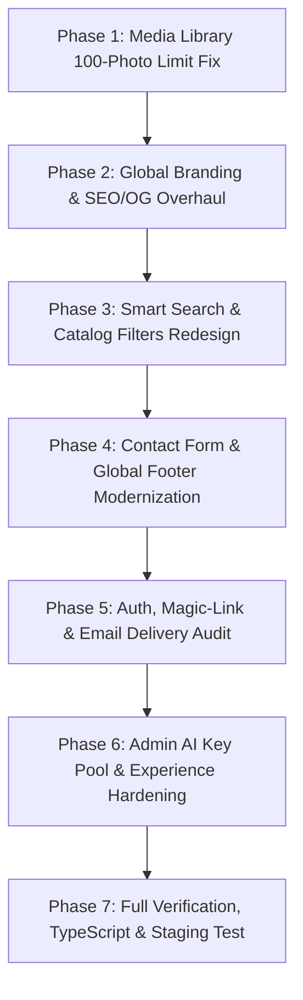

# 🌍 TALAGO TOURS: GLOBAL PLATFORM TRANSFORMATION ROADMAP & SPECIFICATION

**Project:** Talago Tours (Transition to Global Experiences & Booking Platform)  
**Document Version:** 2.0.0  
**Status:** Active Execution  
**Created:** 2026-10-19  

---

## 🎯 Executive Vision
Transform Talago Tours from an Egypt-centric local agency website into a world-class, multi-destination global travel & experiences platform inspired by **GetYourGuide** and **Viator**. While Egypt remains a flagship launch destination, the entire platform architecture, branding, metadata, search, and navigation must be internationally scalable, ready for multi-country expansion and future supplier/partner onboarding.

---

## 📋 Comprehensive Execution Phases

---

### 📦 PHASE 1: Media Library & Storage Architecture (Urgent Bug Fix)
- [x] **1.1 Unlimited Media Fetching & Pagination:**
  - Audit `src/app/api/admin/media/route.ts`.
  - Remove hardcoded `{ limit: 100 }` restriction on Supabase Storage `.list()` calls.
  - Implement recursive / paginated fetching with `offset` and batching to guarantee all assets remain visible and accessible without any older photos vanishing.
- [x] **1.2 Media Library UI Pagination & Search:**
  - Upgrade `src/components/admin/MediaLibraryModal.tsx` and `src/app/(admin)/admin/media/page.tsx` with pagination / virtualized infinite scroll, search by name/folder, and bucket filters (`talago-tour-media`, `talago-media`).
- [x] **1.3 Database Sync for Media Assets:**
  - Ensure uploaded images are properly indexed in the `MediaAsset` table for fast querying, tagging, and assignment.

---

### 🌐 PHASE 2: Global Platform Branding & SEO/OpenGraph Overhaul
- [x] **2.1 Global Meta Tags & Social Previews:**
  - Audit `src/lib/seoMetadata.ts`, `src/app/layout.tsx`, and all public page routes.
  - Remove all restricted "Egypt-only" branding from default OpenGraph titles, descriptions, and keywords.
  - Set default global messaging:
    - *Title:* "Talago | Unforgettable Global Tours, Activities & Experiences"
    - *Description:* "Discover and book top-rated tours, unique experiences, and guided adventures worldwide with instant confirmation and flexible cancellation."
- [x] **2.2 Dynamic Country & Destination Geo-Routing:**
  - Ensure all OpenGraph tags dynamically reflect the specific destination when viewing a city/country, and use the global platform template for generic routes.
- [x] **2.3 Multi-Language Bundle Alignment:**
  - Update `src/locales/` (en, de, ru, it, fr, es, pl, uk) to reflect global platform copy rather than local agency wording.

---

### 🔍 PHASE 3: Smart Universal Search & Catalog Filters
- [x] **3.1 Unified Multi-Entity Search Bar:**
  - Upgrade the search input (`TourSearchHeader.tsx` & homepage hero) to intelligently classify query results into:
    - **Destinations** (e.g., Hurghada, Cairo, Sharm, Luxor, etc. with location pin).
    - **Activities / Categories** (e.g., Sea Trips, Desert Safari, Historical Tours).
    - **Specific Tours** (Exact tour matching).
  - Prevent confusing mixes where searching for a city only yields tour titles.
- [x] **3.2 Clean & Deduplicated Catalog Filters:**
  - Consolidate redundant filter bars in `src/app/(public)/tours/page.tsx`.
  - Fix category filtering so selecting a category (e.g., Marine/Sea) strictly filters matching tours.
  - Ensure tour counters on category badges match actual active tour counts.
- [x] **3.3 Cohesive Sorting:**
  - Implement robust sorting: Popularity, Price (Low to High), Price (High to Low), Duration, and Highest Rated.

---

### 💬 PHASE 4: Global Footer & Contact Form Redesign
- [x] **4.1 Removal of Local Personal Data:**
  - Remove personal direct phone numbers or localized street addresses from the public footer.
- [x] **4.2 Global Inquiry & Contact Form (`/contact` & modal):**
  - Implement a modern, frictionless Contact Form:
    - Name, Email, Phone/WhatsApp, Subject, Message.
    - Saves inquiry to database and dispatches notifications.
- [x] **4.3 Direct Messaging & Social Channels:**
  - Floating WhatsApp support button (instant customer concierge).
  - Official international social media links: Instagram, Facebook, TikTok, Telegram.
- [x] **4.4 Standard Global Footer Navigation:**
  - Company (About Us, Careers, Press).
  - Support (Help Center, Cancellation Policy, Safety & Security, Contact Us).
  - Partnerships (Become a Tour Supplier / Partner Portal preview).

---

### 🔐 PHASE 5: Authentication, Magic-Link & Email Delivery Reliability
- [x] **5.1 Email Service & Resend Audit:**
  - Inspect `src/lib/email.ts` and `src/app/api/auth/magic-link/route.ts`.
  - Implement defensive error handling, test Resend API key status, and provide clear user feedback if email delivery is delayed.
- [x] **5.2 Guest & User Dashboard (`/my-bookings`):**
  - Verify seamless login and phone-based booking lookup.
  - Ensure guests can easily view tickets, download QR boarding passes, and manage bookings.

---

### 🤖 PHASE 6: Admin AI Key Pool & Operational Hardening
- [x] **6.1 Multi-Key Resilient AI Routing:**
  - Robust failover across Gemini (primary + pool keys), Groq, and OpenRouter in `src/lib/ai-router.ts`.
  - In-memory cooldowns and automatic fallback ensure fast translations and content generation without quota lockouts.
- [x] **6.2 Tour & Destination Content Quality:**
  - Verified itineraries, inclusions, and pricing are logically consistent across all 8 supported languages.

---

### 🛡️ PHASE 7: Verification, TypeScript Check & Production Protocol
- [x] **7.1 Local Production Build Validation:**
  - Run full `npx tsc --noEmit` and `npm run build` across all 67+ routes. (Passed: 0 errors, 67/67 static & dynamic routes compiled).
- [ ] **7.2 Zero Deploy Without Explicit Confirmation:**
  - Strictly maintain the deployment lock until explicit user confirmation: `"APPROVED FOR PRODUCTION DEPLOYMENT"`.

---
*Maintained by Antigravity Engineering for Talago Tours.*
