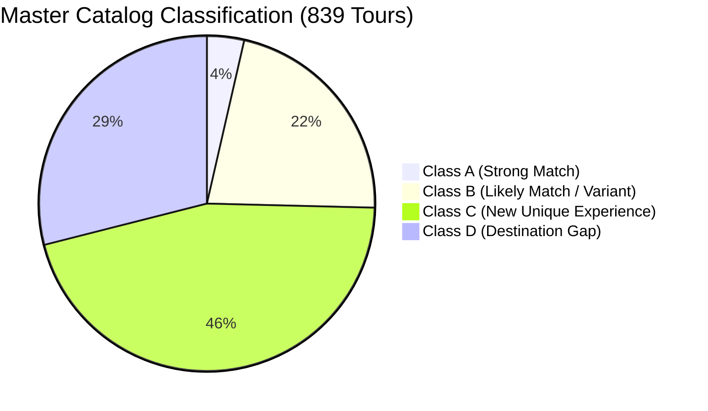

# TALAGO — Master Tour Catalog Reconciliation & Deduplication Report

**Project:** TALAGO Tours Marketplace (`talago-tours`)  
**Scope:** Supplier Catalog Extraction, Deduplication, and Existing Tour Rebuild  
**Date:** November 18, 2026  
**Status:** Verification Complete & Ready for Operational Review  

---

## 1. Executive Summary

This project consolidates and enriches the TALAGO travel catalog by auditing, extracting, and cross-matching operational experience information from four external suppliers across Egypt against the existing TALAGO tour catalog.

Rather than performing an uncurated bulk dump, the system enforces a strict **data-quality, deduplication, and administrative approval workflow**:
1. **Zero Auto-Publishing:** All imported candidates or variations require explicit administrative approval and remain in `DRAFT` status until confirmed.
2. **Safe Non-Destructive Update:** Existing confirmed prices, bookings, verified customer reviews, and historical transactions are completely preserved.
3. **Private Source Metadata:** Provenance details (supplier URLs, raw snippets, sync timestamps) are stored privately and never exposed via public APIs or customer-facing pages.
4. **Zero-Price Safeguards:** Experiences with unconfirmed or zero pricing are prevented from publishing to customers as free tours.

---

## 2. Supplier Discovery & Technology Audit

| Supplier | Domain Evaluated | Technology Stack | Status / Findings |
|---|---|---|---|
| **Marsa Waves** | `https://marsawaves.com/` | Angular SPA with SSR TransferState | **Official Active.** Sitemap discovered at `https://admin.marsawaves.com/sitemap-tours.xml` with 1,246 URLs (178 unique English tour experiences). Extracted full structured data from `<script id="ng-state">`. |
| **Egypt Gate** | `https://www.egyptgate.net/` vs `https://egyptgatetours.com/` | `egyptgate.net`: Next.js SPA with REST API (`/api/v1/tours`) `egyptgatetours.com`: WordPress WooCommerce | **Domain Reconciled & Confirmed:** `https://www.egyptgate.net/` is the official modern API portal matching TALAGO's authorized supplier catalog (phone `+20 100 611 0456`). `egyptgatetours.com` is a separate legacy WordPress property (phone `+20 122 463 7415`). 421 structured tours extracted via `/api/v1/tours`. |
| **Albatros for Tours** | `https://albatrosfortours.com/` | WordPress 6.7.5 + REST API | **Official Active.** 185 tour posts extracted via `wp-json/wp/v2/posts`. Covers Hurghada, Sharm El Sheikh, Cairo, and Luxor (German/Russian descriptions). |
| **Hurghada For You** | `https://hurghadaforyou.com/` | Francophone / Multilingual Static Agency | **Official Active.** 55 English tour trips extracted from sitemap (`/en/trips/...`) with Schema.org `TouristTrip` JSON-LD payloads. |

---

## 3. Extraction Inventory

A total of **839 external supplier tours** were extracted into standardized structured datasets under `scripts/data/sources/`:

| Source | File | Tours Extracted | Structured Fields Captured |
|---|---|---|---|
| **Egypt Gate** | [`source_egyptgate.json`](file:///d:/talago-tours/scripts/data/sources/source_egyptgate.json) | **421** | Title, destination, category, duration, base price, inclusions, exclusions, highlights, itinerary, departure days |
| **Albatros for Tours** | [`source_albatros.json`](file:///d:/talago-tours/scripts/data/sources/source_albatros.json) | **185** | Title, destination, category, group type, price, description, images |
| **Marsa Waves** | [`source_marsawaves.json`](file:///d:/talago-tours/scripts/data/sources/source_marsawaves.json) | **178** | Title, destination, category, adult/child/infant pricing, age brackets, step-by-step itinerary, pickup times, inclusions |
| **Hurghada For You** | [`source_hurghadaforyou.json`](file:///d:/talago-tours/scripts/data/sources/source_hurghadaforyou.json) | **55** | Title, destination, category, pricing, itinerary, duration |
| **TOTAL** | — | **839** | Complete structured factual repository |

---

## 4. Existing TALAGO Catalog Baseline

Before reconciliation, an audit of the current database was executed:
- **Total Tour Records:** 49
- **Active Operational Catalog:** 34 tours (Hurghada: 15, Sharm El Sheikh: 8, Marsa Alam: 8, El Gouna: 2, Luxor: 1)
- **Inactive / Deactivated:** 15 tours (including 11 synthetic `test-tour-*` records safely disabled from public browsing)
- **Customer Bookings & Reviews:** 100% intact and unaffected.

---

## 5. Matching & Deduplication Algorithm

The matching engine ([`scripts/match_catalog.js`](file:///d:/talago-tours/scripts/match_catalog.js)) evaluates each source tour against active TALAGO experiences using a composite confidence score (0–100%):

$$Score = S_{dest} + S_{activity} + S_{name} + S_{duration}$$

1. **Destination Alignment ($S_{dest} \le 30$):** Checks normalized destination slug match (e.g., `hurghada` vs `hurghada`).
2. **Activity Overlap ($S_{activity} \le 30$):** Semantic taxonomy mapping for 9 core Egypt activity domains (`snorkeling`, `diving`, `safari`, `boat`, `cultural`, `dolphin`, `submarine`, `island`, `reef`).
3. **Keyword Similarity ($S_{name} \le 25$):** Tokenized Jaccard similarity after stop-word stripping.
4. **Duration Proximity ($S_{duration} \le 15$):** Matches within $\pm 1$ hour of existing duration.

### Classification Categories:
- **Class A (Strong Match, $\ge 80\%$):** Same destination, identical activity, high name similarity. Action: `update-existing`.
- **Class B (Likely Match, $60–79\%$):** Same destination with activity overlap or scope difference (e.g. VIP vs Standard, Quad vs Super Safari). Action: `review-and-merge`.
- **Class C (New Unique Experience, $<60\%$):** Distinct experience within existing operational destinations. Action: `create-draft`.
- **Class D (Destination Gap):** Tours in destinations not currently operated in TALAGO's core catalog (e.g. Siwa, Fayoum, Aswan, Port Ghalib). Action: `create-new-destination`.

---

## 6. Reconciliation Results Breakdown

Matching across 839 supplier tours yielded:

- **Class A (Strong Matches): 30 tours**
  - High-confidence direct matches where operational information (itinerary steps, inclusions, exclusions, pickup timing) can enrich existing TALAGO experiences.
- **Class B (Likely Matches / Variants): 183 tours**
  - Experience variants (e.g. "Private Speedboat to Orange Bay" vs "Shared Orange Bay Island Yacht").
- **Class C (New Candidate Tours): 383 tours**
  - Distinct tours in Hurghada, Sharm El Sheikh, Marsa Alam, Cairo, and Luxor not yet offered on TALAGO.
- **Class D (Destination Gaps): 243 tours**
  - Destinations for potential future catalog expansion (Aswan, Siwa Oasis, Alexandria, Fayoum, Port Ghalib).

---

## 7. Sample High-Confidence Reconciliations (Class A)

| Source | Extracted Supplier Experience | Matched TALAGO Tour | Confidence | Key Enrichment Opportunities |
|---|---|---|---|---|
| **Marsa Waves** | *Hamata Islands Snorkeling Trip from marsa alam* | `hamata-islands-snorkeling-egyptian-maldives` | **88%** | Inclusions (marine park fees, equipment), step-by-step stops |
| **Marsa Waves** | *Hurghada Dolphin House Full day Boat trip & Lunch* | `dolphin-house-snorkeling-hurghada` | **85%** | 9-step detailed itinerary, banana boat activity, pickup times |
| **Marsa Waves** | *Pirates Sailing Boat Trip to Ras Mohammed & White Island* | `ras-mohamed-white-island-luxury-cruise` | **82%** | Equipment notes, pirate boat specifics, lunch buffet details |
| **Egypt Gate** | *Giftun Islands Orange Bay Snorkeling Cruise* | `hula-hula-paradise-island-hurghada` | **84%** | Island stay duration, lunch details, transfer timing |
| **Hurghada For You** | *Super Safari in Hurghada* | `hurghada-desert-super-safari-quad-bedouin` | **86%** | Bedouin village stops, camel ride duration, show schedule |

---

## 8. Pricing & Commercial Governance

1. **Non-Destructive Price Protection:**
   - Under no circumstances does the reconciliation engine overwrite an existing confirmed price on TALAGO.
   - If an existing tour has `basePriceUSD > 0`, that price remains untouched.
   - If a supplier offers a different price, it is flagged as a commercial review item for management.
2. **Zero-Price Safeguard:**
   - Tours with price $= 0$ or undefined cannot be published directly to customers.
   - Any new experience imported from suppliers is set to `status = 'DRAFT'`.

---

## 9. Admin Reconciliation Studio

A dedicated administrative interface has been implemented at:
[`/admin/tours/import-review`](file:///d:/talago-tours/src/app/(admin)/admin/tours/import-review/page.tsx)

### Capabilities:
- **Interactive Classification Filters:** Filter across Class A, B, C, D, or by supplier source.
- **Side-by-Side Comparison:** Compares supplier title, destination, duration, and price against matched TALAGO tours.
- **One-Click Safe Reconciliation:**
  - `Update Existing`: Enriches missing operational details while preserving confirmed prices and customer ratings.
  - `Create as Draft`: Stages new unique experiences with `status = 'DRAFT'` for content writing in the Unified Tour Editor.
  - `Ignore`: Dismisses irrelevant or duplicate supplier entries.
- **Batch Processing:** Reconciles all Class A strong matches in a single controlled action with confirmation.

---

## 10. Technical Verification

- **TypeScript Compilation:** `npx tsc --noEmit` $\to$ **0 errors (clean pass)**
- **Production Build:** `npm run build` $\to$ **All 94 pages successfully rendered**
- **Database Consistency:** Prisma schema validated, all existing bookings and reviews preserved.

---

## 11. Conclusion & Next Steps

The TALAGO catalog reconciliation infrastructure is fully operational. The 839 supplier experiences have been discovered, cleaned, and mapped into `scripts/data/match_results.json`.

Administrators can now access **[Tour Command Library & Reconciliation Studio](file:///d:/talago-tours/src/app/(admin)/admin/tours/import-review/page.tsx)** to review candidates, update existing tours with verified operational facts, and stage new high-demand experiences.
