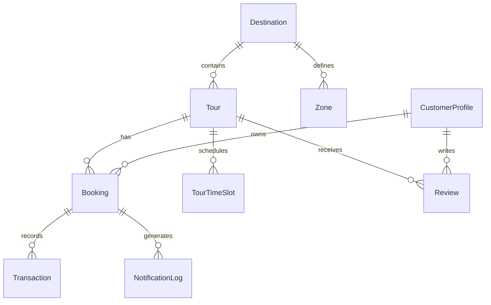

# Database & Data Ownership — Talago Tours

## 1. Database Model & Canonical Boundaries

The database is PostgreSQL hosted on Supabase and accessed through Prisma ORM (`prisma/schema.prisma`).

---

## 2. Key Models & Responsibilities

| Model | Table | Responsibility |
|---|---|---|
| **`Tour`** | `tours` | Canonical catalog record: title, slug, prices, cancellation policy, pickup type, addons, and multilingual JSON `translations`. |
| **`Destination`** | `destinations` | Region container (Hurghada, Sharm, etc.) with localized description and linked transfer zones. |
| **`Booking`** | `bookings` | Authoritative customer transaction record, departure date, guest count, hotel, status, and `@unique idempotencyKey`. |
| **`CustomerProfile`**| `customer_profiles` | Traveler identity: email, phone, Telegram ID, name, verified status. |
| **`Transaction`** | `transactions` | Payment provider records (Paymob, Stripe, Cash on Arrival). |
| **`NotificationLog`** | `notification_logs` | Admin and traveler alert history with read timestamps. |
| **`SystemSetting`** | `system_settings` | Dynamic platform configuration, SEO overrides, and marketplace flags. |

---

## 3. Idempotency & Concurrency Invariants

- Every booking creation in `src/app/api/checkout/initialize/route.ts` requires a client-generated UUID `idempotencyKey`.
- The database enforces uniqueness: `idempotencyKey String? @unique @map("idempotency_key")`.
- If a network retry occurs with the same key, Prisma catches code `P2002` (Unique constraint violation) and returns the existing booking record rather than charging twice or double-booking spots.

---

## 4. Production Data Preservation Policy

- **Never drop production tables:** All schema updates must be additive.
- **Data migrations:** Field transformations must be executed via transactional SQL scripts or safe Prisma migrations.
- **Foreign Keys:** Cascade deletes are strictly disabled on financial records (`Booking`, `Transaction`).
