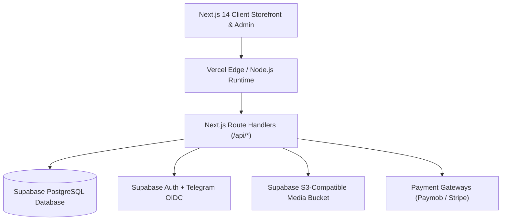

# System Architecture Overview — Talago Tours

## 1. High-Level Topology

Talago Tours is an enterprise-grade tourism marketplace connecting travelers with excursions, yacht charters, and desert adventures across Egypt's premier destinations (Hurghada, Sharm El Sheikh, Marsa Alam, Cairo, Luxor).

---

## 2. Technology Stack

- **Framework:** Next.js 14.2.35 (React 18.3, App Router)
- **Database & ORM:** PostgreSQL on Supabase, managed via Prisma ORM 6.19.3
- **Authentication:** Supabase Auth (Email password & magic links) + Telegram OIDC OAuth2 bridge + Google OAuth
- **Styling:** Tailwind CSS 3.4 with custom design tokens (`#00E5FF` electric cyan, `#070F1E` midnight navy)
- **Testing:** Playwright 1.64.1 (Cross-browser desktop Chromium & Mobile Chrome)
- **Internationalization:** Custom hand-written zero-overhead i18n (`src/locales/`) covering 8 languages
- **Icons:** Lucide React

---

## 3. Directory Layout & Boundaries

- `src/app/(public)/`: Public traveler storefront routes:
  - `/`: Cinematic landing page with Hero, Explore by Interest, and verified carousels.
  - `/tours`: Search catalog with facet filters, multi-currency pricing, and category chips.
  - `/tours/[slug]`: Rich tour detail page with hero slider, booking widget, and itinerary.
  - `/checkout/[tourId]`: Standalone full-page checkout with server-enforced idempotency.
  - `/account`: Customer self-service portal, live chat, booking passes, and vouchers.
  - `/destinations/[slug]`: Destination landing pages with curated tours.
- `src/app/(admin)/admin/`: Admin operational dashboard:
  - Booking operations, dispatch, review moderation, media management, content CMS, and SEO settings.
- `src/app/api/`: Secure serverless route handlers:
  - `/api/auth/*`: Session validation, Telegram authorize/callback, logout.
  - `/api/checkout/*`: Idempotent reservation initialization and payment processing.
  - `/api/public/*`: Public catalog search, customer bookings lookup, live chat messages.
  - `/api/admin/*`: Protected operational endpoints with role validation.
- `src/context/`: Core client state providers:
  - `AuthContext`: Single source of truth for customer identity and session tokens.
  - `LanguageContext`: Multi-language dictionary and active locale state.
  - `CurrencyContext`: Multi-currency converter (USD, EUR, GBP, EGP, PLN).
  - `WishlistContext`: Client-side persistent saved experiences.
