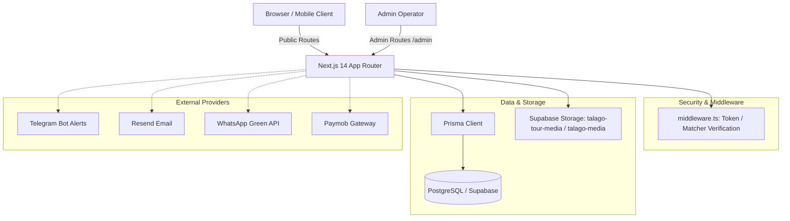

# Talago Tours — Project Context & System Architecture

Updated: 2026-10-26 (Post-Codex & Antigravity Reconciliation)

## 1. Project Overview & Business Purpose

Talago Tours is an online direct-booking marketplace for excursions and tours based in Egypt (primarily Red Sea destinations: Hurghada, Sharm El Sheikh, Marsa Alam, Cairo, Luxor, El Gouna).
The platform is built with Next.js 14 (App Router) and Tailwind CSS, backed by a PostgreSQL database via Prisma ORM and Supabase services (Storage & Auth). The frontend is hosted on Vercel.

### Core Business Pillars
1. **Curated Tour Catalog**: Verified local experiences with rich multilingual content (EN, DE, RU, FR, IT, PL, ES, UK) — no Arabic/RTL is required.
2. **Transparent Booking & Direct Reservation Workflow**: Seamless customer interest capture ("Book" button initiates pending reservation `RES-...` and mirrors to live chat) without treating clicks as fake confirmed payments.
3. **Controlled & Persistent Internal Media Asset Library**: All tour hero and gallery images reside in owned Supabase Storage buckets (`talago-tour-media`, `talago-media`) with logical folder structures, rather than brittle external URLs.
4. **Comprehensive 28-Section Tour Authoring & Text Importer**: A data-entry system allowing operators to paste complete structured descriptions across all 28 form sections and persist them reliably.
5. **Integrated Lead CRM & Live Inbox**: A single operational pane connecting booking leads, customer chat conversations, admin notes, follow-up dates, and notifications (Telegram / WhatsApp / Email).

---

## 2. System Architecture & Tech Stack

- **Framework**: Next.js 14.2 (React 18, TypeScript strict mode, Tailwind CSS, Lucide React).
- **Database**: PostgreSQL hosted via Supabase, accessed via Prisma Client 6.
- **Storage**: Supabase Storage buckets (`talago-tour-media` for tours, `talago-media` for general assets).
- **Authentication**: Admin access secured via `ADMIN_API_TOKEN` checked in `src/middleware.ts` (httpOnly cookie `talago_admin_token` or Bearer header). Customer sessions via Supabase Auth + access tokens (`Booking.accessToken`).

---

## 3. Data Relationships & Schema Highlights

- **`Tour`**: Canonical tour listing containing pricing, logistics, capacity, category, flags, and `translations` (JSON storing multilingual titles, descriptions, inclusions, FAQs, etc.).
- **`MediaAsset`**: Image metadata records associated with tours (`tourId`) and storage file paths.
- **`BookingLead`**: Captures booking intent from public "Book" buttons (`status`: `INTERESTED`, `IN_PROGRESS`, `CONTACTED`, `CONVERTED`, `ABANDONED`). Generates a human-friendly reference `RES-XXXXXXXX`.
- **`LiveChatConversation` & `LiveChatMessage`**: Visitor chat sessions tracked by `visitorToken`. Mirrored from booking leads so admins can chat with prospective guests.
- **`Booking`**: Authoritative reservation records with unique `bookingReference` and 256-bit cryptographically secure `accessToken`.
- **`Review`**: Customer reviews tied to verified confirmed bookings and subject to admin moderation.

---

## 4. Antigravity & Codex Reconciliation History

### Antigravity Baseline:
- Developed the core Next.js 14 foundation, public storefront, multi-currency pricing, initial admin dashboard, and locale packs.
- Introduced `UnifiedTourEditor` with 28 sections, though initial text import was limited to 10 basic fields.
- Implemented `LiveChatWidget` and booking lead capture.

### Codex Worktree Commits & Additions (Branch `codex/marketplace-recovery`):
- Commit `6552525`: Manage reservation inbox notifications & notification logging.
- Commit `c123dfd`: Localize content studio and unify home filters.
- Commit `d332d27`: Turn "Book Now" into pending reservations (`RES-...`) mirrored into live inbox.
- Commit `c1ceba5`: Bypass Vercel image transforms for Supabase media to avoid transform limits.
- Commit `7ce1dbf`: Sanitize formulas in booking exports to prevent CSV injection.
- Commit `83b6617`: Protect partner submissions and form input against XSS.
- Commit `74fdf57`: Make admin pages responsive on mobile.
- Commit `cb13174`: Unify live chat and WhatsApp contact.
- Recent working-tree hardening (TAL-001, TAL-014, TAL-015, TAL-016, TAL-017):
  - Enforced strict integer validation on guest counts and estimated amounts in `booking-interest`.
  - Replaced manual reference entry in public review submission with verified `bookingAccessToken`.
  - Added `no-store` headers to admin analytics summary.
  - Redacted customer emails from console logs in checkout initialization.
  - Hardened guest tier validation and payment scheme parsing in checkout.

---

## 5. Security & Isolation Boundary Notice

As documented in `.agents/skills/security-audit/SKILL.md` and `docs/engineering/PROJECT_AUDIT.md`:
- Running arbitrary test scripts or migrations against live external Supabase databases (`aws-1-eu-central-1.pooler.supabase.com`) without verified sandboxing is restricted.
- Static analysis, unit parsing tests, and type-level verifications are safe and prioritized.
- Destructive catalog operations must only be performed after verified local JSON export/backup.
