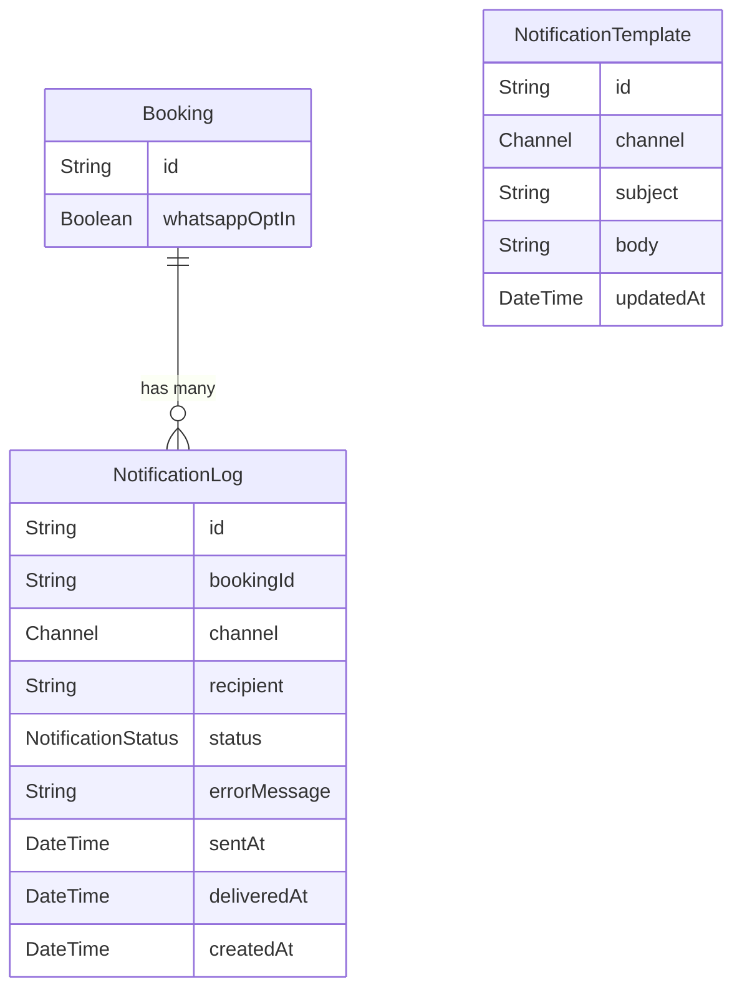

# Data Model: Automated Post-Booking Notification Engine

**Feature**: 017-notification-engine  
**Date**: 2026-05-30

## Entities

### NotificationTemplate

Single-row template storage per channel. Editable by admin.

| Field | Type | Description |
|-------|------|-------------|
| id | UUID (PK) | Primary key |
| channel | Enum | `WHATSAPP` or `EMAIL` |
| subject | String | Email subject line (email only, nullable for WhatsApp) |
| body | String | Template body with `{{placeholder}}` tokens |
| updatedAt | DateTime | Last modified timestamp |

**Constraints**:
- One template per channel (unique constraint on `channel`)
- Body required for both channels
- Subject required for EMAIL only

### NotificationLog

Append-only audit log for every notification attempt.

| Field | Type | Description |
|-------|------|-------------|
| id | UUID (PK) | Primary key |
| bookingId | UUID (FK) | Reference to Booking (Feature 016) |
| channel | Enum | `WHATSAPP` or `EMAIL` |
| recipient | String | Phone number (E.164) or email address |
| status | Enum | `SENT`, `DELIVERED`, `FAILED` |
| errorMessage | String? | Error details if FAILED |
| sentAt | DateTime | When the notification was sent |
| deliveredAt | DateTime? | When delivery was confirmed (webhook) |
| createdAt | DateTime | Record creation timestamp |

**Indexes**:
- `@@index([bookingId])` — lookup by booking
- `@@index([channel, status])` — admin filtering

**State Transitions**:
```
created → SENT (on API call) → DELIVERED (on webhook)
                      ↓
                   FAILED (on error)
```

### Booking (Modified - from Feature 16)

Add field to Booking model:

| Field | Type | Description |
|-------|------|-------------|
| whatsappOptIn | Boolean | Customer opted in to WhatsApp notifications (default: true) |

**Relationship**:
- Booking has many NotificationLogs (relation field: `notifications`)

## Enums

```typescript
enum Channel {
  WHATSAPP
  EMAIL
}

enum NotificationStatus {
  SENT
  DELIVERED
  FAILED
}
```

## Relations

