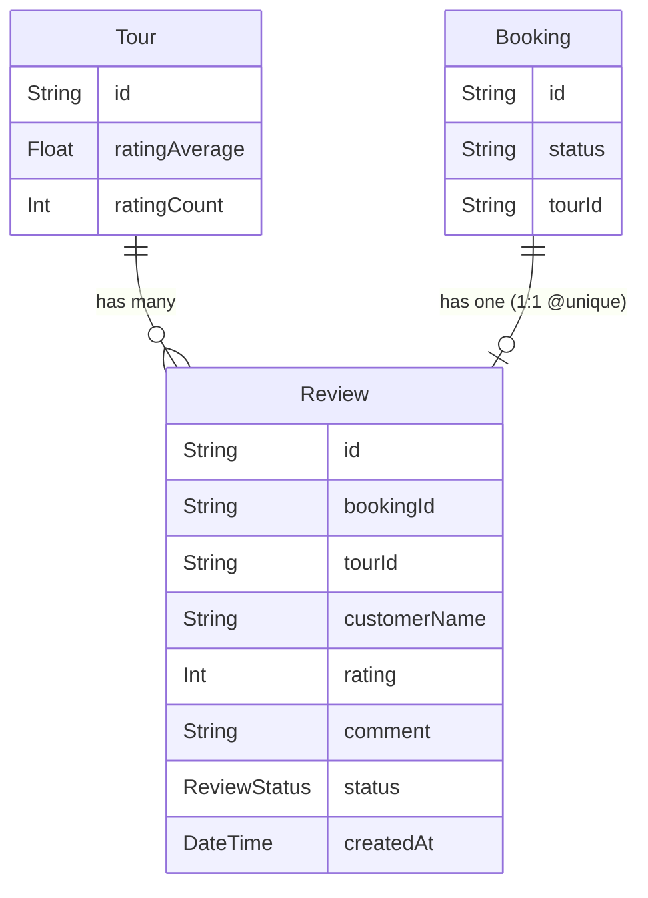

# Data Model: Verified Customer Reviews & Admin Moderation Engine

**Feature**: 018-reviews-moderation  
**Date**: 2026-05-31

## Entities

### Review

Holds verified, customer-submitted reviews for completed and confirmed bookings.

| Field | Type | Attributes / Constraints | Description |
|-------|------|-------------------------|-------------|
| `id` | String | `@id` `@default(uuid())` | Unique review identifier |
| `bookingId` | String | `@unique` | Reference to unique booking reference |
| `tourId` | String | | Reference to target tour ID |
| `customerName`| String | | Display name of the reviewing customer |
| `rating` | Int | Checked in app logic (1 to 5) | Feedback rating score |
| `comment` | String | `@db.Text` | Content of the review |
| `status` | ReviewStatus| `@default(PENDING)` | Moderation status |
| `createdAt` | DateTime | `@default(now())` | Submission timestamp |
| `updatedAt` | DateTime | `@updatedAt` | Last modification timestamp |

**Indexes**:
- `@@index([tourId, status])` — lookup approved reviews for a tour.

**Relations**:
- `booking` -> `Booking` (fields: `bookingId`, references: `id`, `onDelete: Cascade`)
- `tour` -> `Tour` (fields: `tourId`, references: `id`, `onDelete: Cascade`)

---

### Tour (Modified)

Each tour maintains cached aggregate scores to optimize index queries and avoid performance overhead during catalog displays.

| Field | Type | Attributes / Constraints | Description |
|-------|------|-------------------------|-------------|
| `ratingAverage`| Float | `@default(0.0)` | Cached arithmetic mean of approved ratings |
| `ratingCount` | Int | `@default(0)` | Total number of approved reviews |

---

### Booking (Existing Verification Source)

The validation endpoint queries Booking to ensure a review is valid and non-duplicate.

**States Checked**:
- `Booking.status` must be `CONFIRMED`.
- `Booking.tourId` must match the payload `tourId`.
- No existing `Review` node can be associated with this `Booking.id` (enforced by 1:1 `@unique` relation).

---

## Enums

### ReviewStatus

```prisma
enum ReviewStatus {
  PENDING
  APPROVED
  REJECTED
}
```

## State Transitions

```
[Customer Submit] ──> PENDING (Invisible publicly)
                         │
         ┌───────────────┴───────────────┐
         ▼                               ▼
     APPROVED                        REJECTED
(Cached rating updated,           (Invisble publicly,
 review goes live)                 recomputed aggregate ignores)
```

## Entity Relation Diagram

