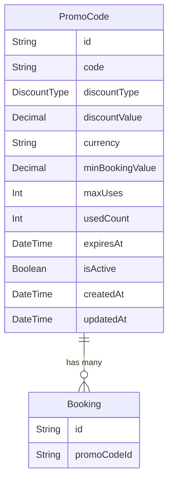

# Data Model: Dynamic Promo Codes, Variable Pricing Rules & Coupon Campaign Engine

**Feature**: 019-promo-codes-campaigns  
**Date**: 2026-05-31

## Entities

### PromoCode

Holds promotional pricing rules that can be applied to bookings at checkout.

| Field | Type | Attributes / Constraints | Description |
|-------|------|-------------------------|-------------|
| `id` | String | `@id` `@default(uuid())` | Unique promo code identifier |
| `code` | String | `@unique` | Promo code string (stored lowercase, case-insensitive lookup) |
| `discountType` | DiscountType | | Percentage or fixed amount |
| `discountValue` | Decimal | | Discount magnitude (percentage value 0-100, or fixed amount) |
| `currency` | String | `@default("EGP")` | Currency this code applies to (reject if checkout currency differs) |
| `minBookingValue` | Decimal | `@default(0)` | Minimum booking subtotal required to use this code |
| `maxUses` | Int | | Maximum number of times this code can be applied |
| `usedCount` | Int | `@default(0)` | Current usage count (incremented atomically on booking creation) |
| `expiresAt` | DateTime | | Code is invalid after this timestamp |
| `isActive` | Boolean | `@default(true)` | Manual deactivation toggle |
| `createdAt` | DateTime | `@default(now())` | Creation timestamp |
| `updatedAt` | DateTime | `@updatedAt` | Last modification timestamp |

**Indexes**:
- `@@index([code, isActive])` — fast lookup for the most common query pattern (find active code by code string).

**Relations**:
- `bookings` -> `Booking[]` (field: `promoCodeId`, references: `id`, `onDelete: SetNull`)

### Booking (Modified)

Added an optional relation to PromoCode for discount audit trail.

| Field | Type | Attributes / Constraints | Description |
|-------|------|-------------------------|-------------|
| `promoCodeId` | String? | `@default(dbgenerated(""))` | Reference to applied promo code (nullable) |

**Relations**:
- `promoCode` -> `PromoCode` (fields: `promoCodeId`, references: `id`, `onDelete: SetNull`)

### Validation Rules Matrix

| Rule | Field(s) | Condition | Error Message |
|------|----------|-----------|---------------|
| Existence | `code` | PromoCode record must exist | "Invalid promo code" |
| Active | `isActive` | `isActive === true` | "This promo code is no longer available" |
| Expiry | `expiresAt` | `new Date() < expiresAt` | "This promo code has expired" |
| Usage cap | `usedCount`, `maxUses` | `usedCount < maxUses` | "This promo code has reached its usage limit" |
| Min booking value | `minBookingValue`, `bookingValue` | `bookingValue >= minBookingValue` | "Minimum booking value of [amount] [currency] required" |
| Currency match | `currency`, `bookingCurrency` | `currency === bookingCurrency` | "This promo code is not valid for [currency] bookings" |

## Enums

### DiscountType

```prisma
enum DiscountType {
  PERCENTAGE
  FIXED_AMOUNT
}
```

## State Transitions

```
[Admin Create] ──> Active (isActive=true, usedCount=0)
                      │
         ┌────────────┴────────────────────┐
         │            │                    │
         ▼            ▼                    ▼
     Exhausted     Expired            Deactivated
  (usedCount >=  (now > expiresAt)   (isActive=false)
   maxUses)
```

## Entity Relation Diagram


