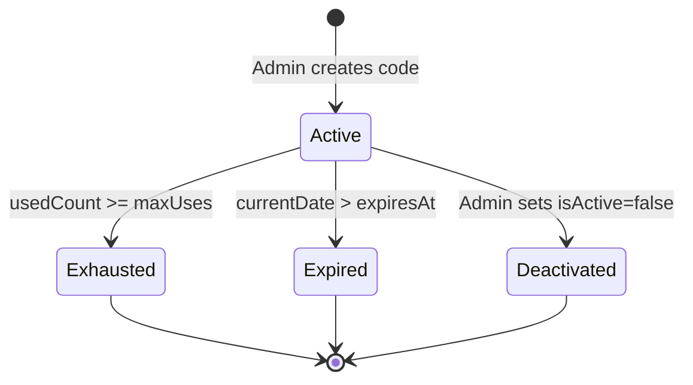
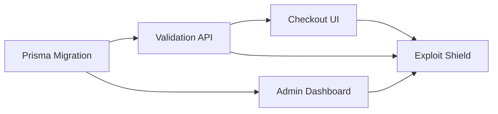

# Implementation Plan: Dynamic Promo Codes, Variable Pricing Rules & Coupon Campaign Engine

**Branch**: `019-promo-codes-campaigns` | **Date**: 2026-05-31 | **Spec**: `specs/019-promo-codes-campaigns/spec.md`

**Input**: Feature specification from `specs/019-promo-codes-campaigns/spec.md`

## Summary

Add server-side promo code validation and discount engine to the Talago checkout flow. Customers enter a promo code at checkout and see instant validation feedback. The discount is applied server-side within an atomic transaction that also increments the usage counter — preventing race conditions. Administrators manage promo codes (create, list, monitor usage) via a dedicated admin campaigns dashboard.

## Technical Context

**Language/Version**: TypeScript 5.4+, Next.js 14.2

**Primary Dependencies**: `@prisma/client` ^5.14 (PostgreSQL), `next` ^14.2, `react` ^18.3, `tailwindcss` ^3.4

**Storage**: PostgreSQL via Prisma ORM — Prisma Decimal type for monetary precision, interactive `$transaction` for atomic usage-increment + booking creation

**Testing**: Not yet configured — standard `vitest` for unit/integration, `playwright` for E2E (consistent with Feature 018 patterns)

**Target Platform**: Linux server (Node.js), modern browsers (Chrome, Safari, Firefox, Edge)

**Project Type**: Web application (Next.js App Router)

**Performance Goals**: Promo validation lookups <100ms server-side (simple indexed PK + composite index query); atomic transaction overhead <50ms

**Constraints**: Server-only validation — never trust client-side discount amounts; LTR layout; zero third-party animation libraries; conversion palette (`#FF5B00` coral for CTAs, `#00473F` forest for success badges)

**Scale/Scope**: Single-region deployment, ~100s bookings/day; single promo code per booking (stacking prohibited)

## Constitution Check

*GATE: Must pass before Phase 0 research. Re-check after Phase 1 design.*

| Gate | Constitution Principle | Compliance | Justification |
|------|----------------------|------------|---------------|
| G1 | Server-First Mindset (RSC by default) | ✅ PASS | Promo validation API is a server route; `PromoForm.tsx` needs `"use client"` for input/button interaction — justified |
| G2 | Strict Type-Safety (`any` prohibited) | ✅ PASS | All API payloads, Prisma queries, and discount calculations use typed interfaces |
| G3 | Conversion Palette Tokens | ✅ PASS | Coral `#FF5B00` on Apply CTA button; Forest `#00473F` on success badge; neutral canvas for form background |
| G4 | Fail-Safe Form Interactions | ✅ PASS | Apply button shows loading spinner and disables on submit; error messages inline |
| G5 | Zero Framer Motion / GSAP | ✅ PASS | All transitions use native Tailwind classes (`transition-all duration-300 ease-in-out`) |
| G6 | LTR Layout Orientation | ✅ PASS | All promo form, sidebar, and admin grid layouts are strictly LTR |

**No violations found — Complexity Tracking table not required.**

## Project Structure

### Documentation (this feature)

```text
specs/019-promo-codes-campaigns/
├── plan.md              # This file
├── research.md          # Phase 0 output
├── data-model.md        # Phase 1 output
├── quickstart.md        # Phase 1 output
├── contracts/
│   ├── promo-validate.md
│   ├── promo-admin.md
│   └── checkout-initialize.md
└── tasks.md             # Phase 2 output (generated by /speckit.tasks)
```

### Source Code (repository root)

```text
app/
├── api/
│   ├── public/
│   │   └── promo/
│   │       └── validate/
│   │           └── route.ts          # MILESTONE 2: promo validation endpoint
│   └── checkout/
│       └── initialize/
│           └── route.ts              # MILESTONE 4: exploit shield re-validation
├── admin/
│   └── campaigns/
│       └── page.tsx                  # MILESTONE 4: admin campaign dashboard
├── page.tsx                          # existing landing page
└── layout.tsx                        # existing root layout

components/
├── checkout/
│   ├── PromoForm.tsx                 # MILESTONE 3: promo code input + validation UI
│   └── PriceSummarySidebar.tsx       # MILESTONE 3: discount display in sidebar

prisma/
└── schema.prisma                     # MILESTONE 1: DiscountType enum + PromoCode model + Booking field

utils/
└── promo.ts                          # Discount calculation logic (shared between validate + checkout init)
```

**Structure Decision**: Standard Next.js App Router layout. Promo validation lives under `app/api/public/promo/validate` (public-facing but server-only execution). Admin routes under `app/admin/campaigns`. Shared discount math in `utils/promo.ts`.

### Entity Lifecycle Map



## Milestone Dependencies



### Milestone Breakdown

- **M1**: Prisma schema — `DiscountType` enum, `PromoCode` model, `Booking.promoCodeId` relation
- **M2**: `POST /api/public/promo/validate` — constraint matrix checks, discount calculation
- **M3**: `PromoForm.tsx` + `PriceSummarySidebar.tsx` — Apply UI, success/error feedback, price updates
- **M4**: `app/admin/campaigns/page.tsx` — CRUD grid for promo codes with usage progress bar
- **M5**: Refactor checkout initialize — re-validate promo before payment gateway transmission
